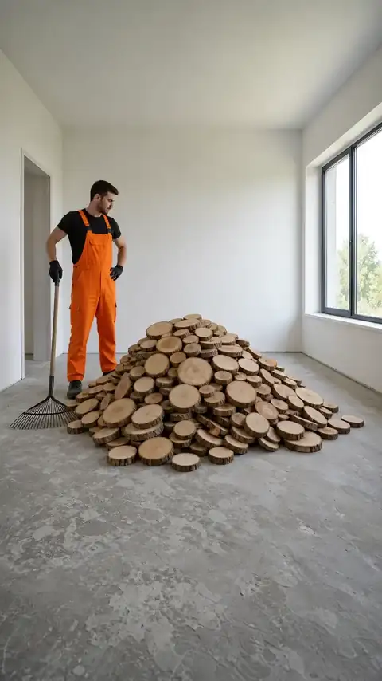

# Wood Pile to Bedroom Floor — by @Ruslanchain

[← Back to Community Examples](../../EXAMPLES.md) · Category: Video · Model: `Seedance 2.0`

<a href="https://x.com/Ruslanchain/status/2117620262606614546"></a>

**[▶ Watch the full video on X](https://x.com/Ruslanchain/status/2117620262606614546)** — the preview above is a short silent clip.

Source: **[@Ruslanchain on X](https://x.com/Ruslanchain/status/2117620262606614546)** · Creator: [Ruslan Ai](https://x.com/Ruslanchain)

## Prompt

```text
Vertical timelapse-style renovation video, fixed wide shot of a bright empty room with white walls, a large window on the right and blue painter's tape along the skirting boards. A workman in orange overalls dumps a heap of round log-slice discs onto the bare floor and rakes them out flat, arranging the wooden rounds face-up into an even mosaic pattern. Several more workers in orange overalls kneel down fitting the slices tightly together, then pour milky-clear epoxy resin from buckets and spread it with squeegees until every gap fills like liquid glass. One worker wearing ear defenders runs a floor buffing machine across the curing surface while another smooths the edges near the walls; fast-motion cuts show the wet resin self-leveling and turning glossy, locking the amber wood rings into a seamless polished floor. Smooth transition to the finished bedroom: the same room now styled with a light oak bed dressed in white linen, a bedside table with a small lamp and a framed print above the headboard, sunlight streaming through the window, the wood-slice epoxy floor gleaming with mirror-like reflections. Realistic documentary style, warm natural light, satisfying before-and-after transformation.
```

## Try it

Paste the prompt into **[vinano.ai](https://vinano.ai?utm_source=github&utm_medium=readme&utm_campaign=awesome-image-video-prompts-updating&utm_content=x-page-try)** to generate your own version.

> The video and prompt belong to @Ruslanchain ([original post](https://x.com/Ruslanchain/status/2117620262606614546)) and are shown here with credit for reference. Creators can ask for changes or removal by opening an issue.
