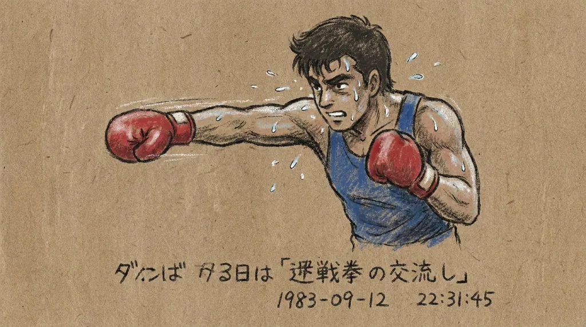

# 1980s Anime Freeze Frame — by @thierrybezier

[← Back to Community Examples](../../EXAMPLES.md) · Category: Illustration & 3D · Model: `Nano Banana`

<a href="https://x.com/thierrybezier/status/2118769805587054692"></a>

Source: **[@thierrybezier on X](https://x.com/thierrybezier/status/2118769805587054692)** · Creator: [Thierry Bézier｜ティエリー・ベジエ](https://x.com/thierrybezier)

## Prompt

```text
1980 anime freeze frame in chalk pastel, boxer mid punch, sweat, rough paper grain
```

## Try it

Paste the prompt into **[vinano.ai](https://vinano.ai?utm_source=github&utm_medium=readme&utm_campaign=awesome-image-video-prompts-updating&utm_content=x-page-try)** to generate your own version.

> The image and prompt belong to @thierrybezier ([original post](https://x.com/thierrybezier/status/2118769805587054692)) and are shown here with credit for reference. Creators can ask for changes or removal by opening an issue.
