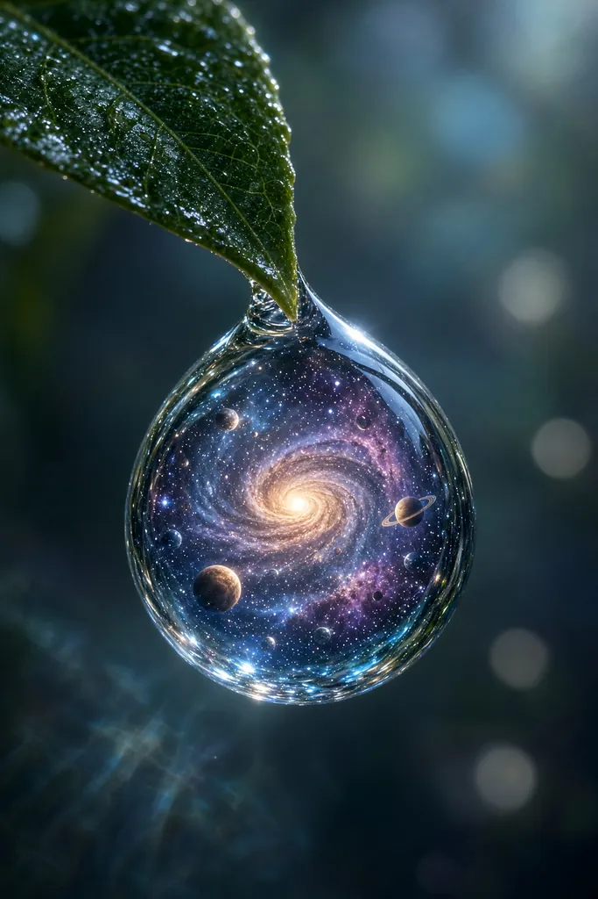

# Galaxy in a Water Droplet — by @StanMacNabb

[← Back to Community Examples](../../EXAMPLES.md) · Category: Photography · Model: `Grok`

<a href="https://x.com/StanMacNabb/status/2118105347457978844"></a>

Source: **[@StanMacNabb on X](https://x.com/StanMacNabb/status/2118105347457978844)** · Creator: [Stan MacNabb](https://x.com/StanMacNabb)

## Prompt

```text
Crystal-clear water droplet suspended in mid-air or hanging from a leaf, macro photography style, hyper-realistic refraction and caustics. Inside the droplet: a luminous spiral galaxy with glowing planets orbiting, dense star clusters, soft nebulae, and celestial light rays escaping through the water surface. Soft bokeh background, ethereal lighting, intricate surface highlights, highly detailed, cinematic.
```

## Try it

Paste the prompt into **[vinano.ai](https://vinano.ai?utm_source=github&utm_medium=readme&utm_campaign=awesome-image-video-prompts-updating&utm_content=x-page-try)** to generate your own version.

> The image and prompt belong to @StanMacNabb ([original post](https://x.com/StanMacNabb/status/2118105347457978844)) and are shown here with credit for reference. Creators can ask for changes or removal by opening an issue.
