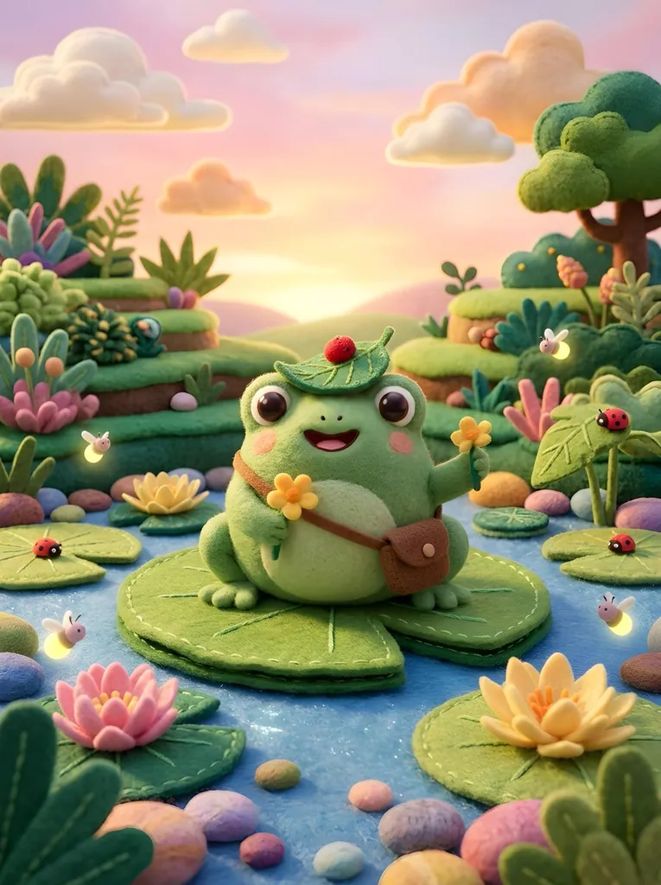

# Felt Frog on a Lily Pad — by @heathergreen

[← Back to Community Examples](../../EXAMPLES.md) · Category: Illustration & 3D · Model: `Nano Banana Pro`

<a href="https://x.com/heathergreen/status/2108120225119973526"></a>

Source: **[@heathergreen on X](https://x.com/heathergreen/status/2108120225119973526)** · Creator: [Heather Green](https://x.com/heathergreen)

## Prompt

```text
A cute, 3D and felt-like scene of a cartoon-style frog sitting on a large lily pad in a pond. The frog is green with large, expressive eyes and a wide smile. It wears a small leaf as a hat with a berry on top and a satchel over its shoulder. The frog holds a small yellow flower in its right hand. The pond is filled with lily pads, pink and yellow water lilies, and colorful pebbles. The background features a lush, vibrant landscape with rolling hills, exotic plants, and a soft, glowing sunset sky with fluffy clouds. Fireflies and ladybugs are scattered throughout the scene, adding to the magical atmosphere. The overall image has a whimsical and enchanting feel, with soft lighting and a pastel color palette.
```

## Try it

Paste the prompt into **[vinano.ai](https://vinano.ai?utm_source=github&utm_medium=readme&utm_campaign=awesome-image-video-prompts-updating&utm_content=x-page-try)** to generate your own version.

> The image and prompt belong to @heathergreen ([original post](https://x.com/heathergreen/status/2108120225119973526)) and are shown here with credit for reference. Creators can ask for changes or removal by opening an issue.
