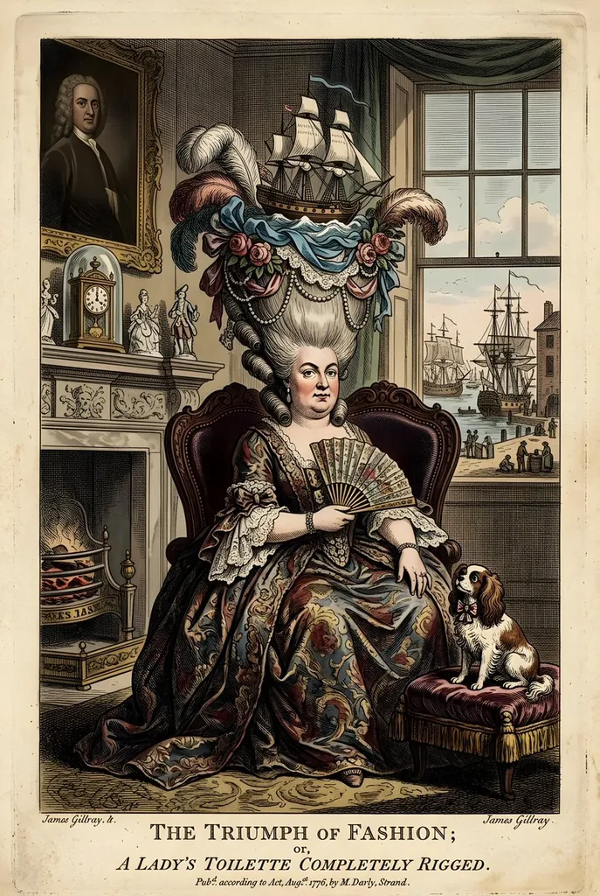

# Vintage British Caricature — by @heathergreen

[← Back to Community Examples](../../EXAMPLES.md) · Category: Illustration & 3D · Model: `Nano Banana 2`

<a href="https://x.com/heathergreen/status/2097112687675117974"></a>

Source: **[@heathergreen on X](https://x.com/heathergreen/status/2097112687675117974)** · Creator: [Heather Green](https://x.com/heathergreen)

## Prompt

```text
A vintage British caricature depicts a woman with an elaborate hairstyle adorned with a sailing ship, flowers, and feathers. She is seated in an ornate chair, wearing a richly decorated dress and holding a fan. The background shows a lavish interior with a fireplace, clock, and a window overlooking a harbor scene. A small dog sits on a cushion to her right. The overall style is that of a 18th-century satirical print.
```

## Try it

Paste the prompt into **[vinano.ai](https://vinano.ai?utm_source=github&utm_medium=readme&utm_campaign=awesome-image-video-prompts-updating&utm_content=x-page-try)** to generate your own version.

> The image and prompt belong to @heathergreen ([original post](https://x.com/heathergreen/status/2097112687675117974)) and are shown here with credit for reference. Creators can ask for changes or removal by opening an issue.
