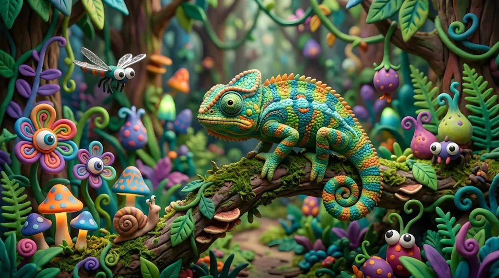

# Claymation Chameleon — by @heathergreen

[← Back to Community Examples](../../EXAMPLES.md) · Category: Illustration & 3D · Model: `Nano Banana 2`

<a href="https://x.com/heathergreen/status/2096750301134881054"></a>

Source: **[@heathergreen on X](https://x.com/heathergreen/status/2096750301134881054)** · Creator: [Heather Green](https://x.com/heathergreen)

## Prompt

```text
A vibrant, whimsical claymation scene depicts a colorful chameleon perched on a moss-covered branch in a lush, fantastical forest. The chameleon, with its intricate patterns of green, blue, orange, and yellow scales, gazes intently to the left. Surrounding it are an array of fantastical flora and fauna, also rendered in clay. These include glowing mushrooms, peculiar flowers with eyeball centers, whimsical insects with googly eyes, and strange, bulbous fruits. The background is a soft blur of more trees and foliage, creating a sense of depth and enchantment. The overall impression is one of a magical, miniature world brought to life.
```

## Try it

Paste the prompt into **[vinano.ai](https://vinano.ai?utm_source=github&utm_medium=readme&utm_campaign=awesome-image-video-prompts-updating&utm_content=x-page-try)** to generate your own version.

> The image and prompt belong to @heathergreen ([original post](https://x.com/heathergreen/status/2096750301134881054)) and are shown here with credit for reference. Creators can ask for changes or removal by opening an issue.
