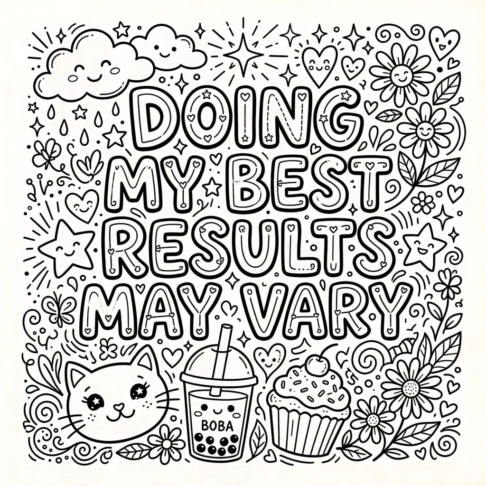

# Doing My Best Coloring Page — by @heathergreen

[← Back to Community Examples](../../EXAMPLES.md) · Category: UI & Graphic · Model: `Nano Banana 2`

<a href="https://x.com/heathergreen/status/2091812770274492604"></a>

Source: **[@heathergreen on X](https://x.com/heathergreen/status/2091812770274492604)** · Creator: [Heather Green](https://x.com/heathergreen)

## Prompt

```text
A black and white line drawing features the text "DOING MY BEST RESULTS MAY VARY" in large, bold, bubble-style lettering. The text is surrounded by various cute and whimsical elements, including smiling stars, a cat face, clouds, daisies, hearts, cupcakes, a boba tea, and sparkly starbursts. The overall composition is dense and playful, designed as a coloring page.
```

## Try it

Paste the prompt into **[vinano.ai](https://vinano.ai?utm_source=github&utm_medium=readme&utm_campaign=awesome-image-video-prompts-updating&utm_content=x-page-try)** to generate your own version.

> The image and prompt belong to @heathergreen ([original post](https://x.com/heathergreen/status/2091812770274492604)) and are shown here with credit for reference. Creators can ask for changes or removal by opening an issue.
