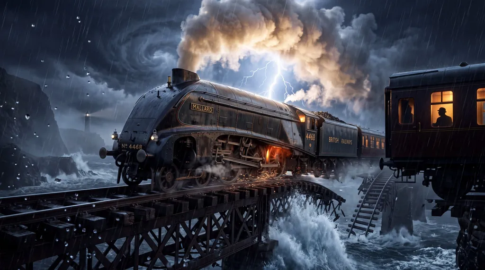

# Steam Locomotive on a Collapsing Bridge — by @Madhuribhai

[← Back to Community Examples](../../EXAMPLES.md) · Category: Photography · Model: `Nano Banana Pro`

<a href="https://x.com/Madhuribhai/status/2097388333886546238"></a>

Source: **[@Madhuribhai on X](https://x.com/Madhuribhai/status/2097388333886546238)** · Creator: [WeWant Mars](https://x.com/Madhuribhai)

## Prompt

```text
Ultra-realistic cinematic 4K image of a colossal vintage steam locomotive racing across an enormous collapsing railway bridge above a violent ocean during a supernatural-looking but physically grounded thunderstorm. The train is captured at the exact moment a massive wave crashes against the bridge far below, while lightning illuminates the entire scene. Hundreds of rain droplets freeze sharply in the foreground, reflecting tiny fragments of light. The locomotive is incredibly detailed: weathered black steel, polished brass components, glowing furnace light, realistic steam escaping from valves, wet metallic surfaces, spinning wheels throwing water and sparks against the rails.

The environment is breathtaking and immense: towering dark cliffs disappearing into storm clouds, a distant lighthouse barely visible through heavy rain, enormous waves exploding against rocks, dramatic clouds spiraling across the sky, mist flowing beneath the bridge, broken sections of railway disappearing into the distance. A lone passenger silhouette is visible through one warmly illuminated train window, creating mystery and emotional storytelling.

Composition uses an extreme low-angle perspective from beside the railway tracks, making the locomotive feel enormous and powerful. Strong leading lines from the rails pull the eye directly toward the train. Lightning provides dramatic backlighting and creates a brilliant rim around the locomotive and steam. Warm interior light contrasts naturally against the cold storm atmosphere. Photorealistic materials, physically accurate reflections, realistic rain behavior, atmospheric perspective, volumetric mist, cinematic depth of field, subtle motion blur on the wheels while the locomotive remains razor sharp, HDR lighting, natural film grain, incredible micro-details, realistic scale, professional Hollywood cinematography, 35mm anamorphic lens aesthetic, high dynamic range, breathtaking visual storytelling, crystal-clear 4K Ultra HD, no text, no logo, no watermark, no artificial-looking CGI, no cartoon style.

The key visual: gigantic train + collapsing bridge + ocean storm + lightning + tiny human silhouette = scale, danger, mystery, and cinematic storytelling in one frame.
```

## Try it

Paste the prompt into **[vinano.ai](https://vinano.ai?utm_source=github&utm_medium=readme&utm_campaign=awesome-image-video-prompts-updating&utm_content=x-page-try)** to generate your own version.

> The image and prompt belong to @Madhuribhai ([original post](https://x.com/Madhuribhai/status/2097388333886546238)) and are shown here with credit for reference. Creators can ask for changes or removal by opening an issue.
