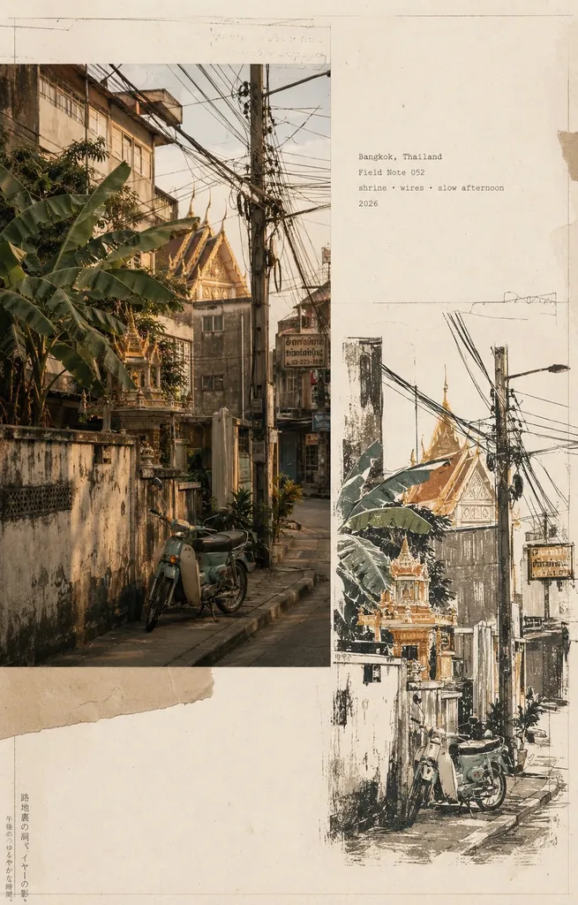

# Vintage Japanese Travel Journal Collage — by @aniyaintel

[← Back to Community Examples](../../EXAMPLES.md) · Category: Poster Design · Model: `Nano Banana Pro`

<a href="https://x.com/aniyaintel/status/2093658819427741802"></a>

Source: **[@aniyaintel on X](https://x.com/aniyaintel/status/2093658819427741802)** · Creator: [Aniya](https://x.com/aniyaintel)

## Prompt

```text
Create a premium vintage Japanese travel-journal editorial collage in vertical 4:5 format, featuring four distinct city sections—Bangkok, Thailand; Lisbon, Portugal; Marrakech, Morocco; Istanbul, Turkey. Each section combines a warm photorealistic documentary street photograph with a matching imperfect hand-drawn screen-print illustration, arranged asymmetrically on aged cream paper with torn-paper layers, archival borders, subtle pencil marks, typewriter captions, faded ink, paper fibers, and authentic 35mm analog grain. Bangkok: shrine, tangled wires, tropical greenery, teal motorbike; Lisbon: yellow tram, steep cobblestone street, balconies and river view; Marrakech: terracotta medina, palms, rugs and ornate minaret; Istanbul: steep stone street, Galata Tower, Bosphorus and vintage scooter. Use a restrained palette of sage, ochre, terracotta, mustard, charcoal and warm ivory, with sophisticated editorial art direction, muted contrast, natural light, handmade imperfections, and museum-quality travel-zine aesthetics. Small archival labels: “Bangkok / Field Note 052”, “Lisbon / Field Note 031”, “Marrakech / Field Note 017”, “Istanbul / Field Note 039”. No logos, watermark, HDR, oversaturation, or modern clutter.
```

## Try it

Paste the prompt into **[vinano.ai](https://vinano.ai?utm_source=github&utm_medium=readme&utm_campaign=awesome-image-video-prompts-updating&utm_content=x-page-try)** to generate your own version.

> The image and prompt belong to @aniyaintel ([original post](https://x.com/aniyaintel/status/2093658819427741802)) and are shown here with credit for reference. Creators can ask for changes or removal by opening an issue.
