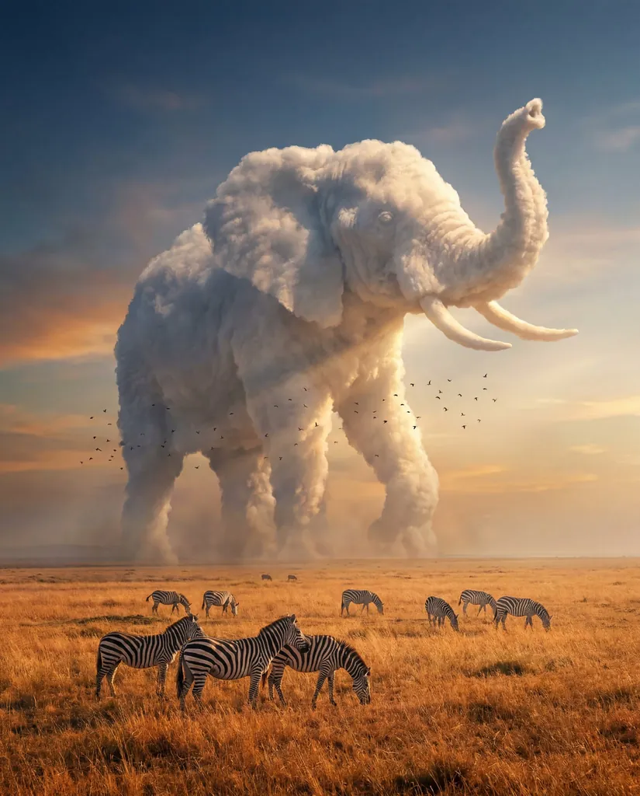

# Cloud Elephant Over the Savanna — by @itxabdullaa

[← Back to Community Examples](../../EXAMPLES.md) · Category: Photography · Model: `Nano Banana Pro`

<a href="https://x.com/itxabdullaa/status/2057817382773731346"></a>

Source: **[@itxabdullaa on X](https://x.com/itxabdullaa/status/2057817382773731346)** · Creator: [ÀBDŪLLÂH](https://x.com/itxabdullaa)

## Prompt

```text
Hyper-realistic photography of massive volumetric clouds forming the shape of a majestic elephant, highly detailed and anatomically accurate cloud structure with enormous tusks and a raised trunk, soft yet dense cumulus clouds with realistic depth and texture, dramatic golden-hour lighting, sunlight rays piercing through the clouds, subtle shadows and highlights enhancing form.
Foreground: a vast African savanna meadow with realistic dry grass, atmospheric perspective, and cinematic depth of field. Multiple zebras grazing naturally across the field. Mid-air: flock of birds circling around the giant elephant cloud, adding scale and motion.
Environment: cinematic sky with warm orange and blue gradient tones, slight haze, natural color grading, ultra-realistic lighting, global illumination, volumetric fog, physically accurate shadows.
Style: DSLR photography, 85mm lens, f/2.8 aperture, shallow depth of field, HDR, 8K resolution, razor-sharp focus, intricate details, photorealism, no CGI look.
Mood: majestic, calm, surreal yet believable, wildlife documentary realism.
```

## Try it

Paste the prompt into **[vinano.ai](https://vinano.ai?utm_source=github&utm_medium=readme&utm_campaign=awesome-image-video-prompts-updating&utm_content=x-page-try)** to generate your own version.

> The image and prompt belong to @itxabdullaa ([original post](https://x.com/itxabdullaa/status/2057817382773731346)) and are shown here with credit for reference. Creators can ask for changes or removal by opening an issue.
