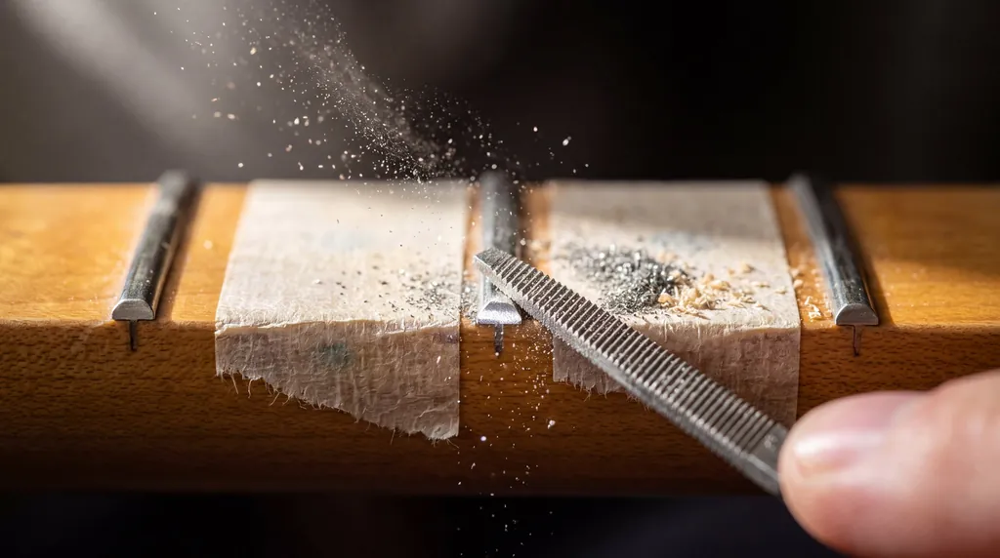

# Fret Dressing Macro — by @GlennHasABeard

[← Back to Community Examples](../../EXAMPLES.md) · Category: Photography · Model: `Nano Banana 2`

<a href="https://x.com/GlennHasABeard/status/2095499999626821919"></a>

Source: **[@GlennHasABeard on X](https://x.com/GlennHasABeard/status/2095499999626821919)** · Creator: [Glenn Williams](https://x.com/GlennHasABeard)

## Prompt

```text
the middle fret mid-dressing, bright raw nickel silver where the file has cut, the neighboring fret ends still square and unfinished for contrast
```

## Try it

Paste the prompt into **[vinano.ai](https://vinano.ai?utm_source=github&utm_medium=readme&utm_campaign=awesome-image-video-prompts-updating&utm_content=x-page-try)** to generate your own version.

> The image and prompt belong to @GlennHasABeard ([original post](https://x.com/GlennHasABeard/status/2095499999626821919)) and are shown here with credit for reference. Creators can ask for changes or removal by opening an issue.
