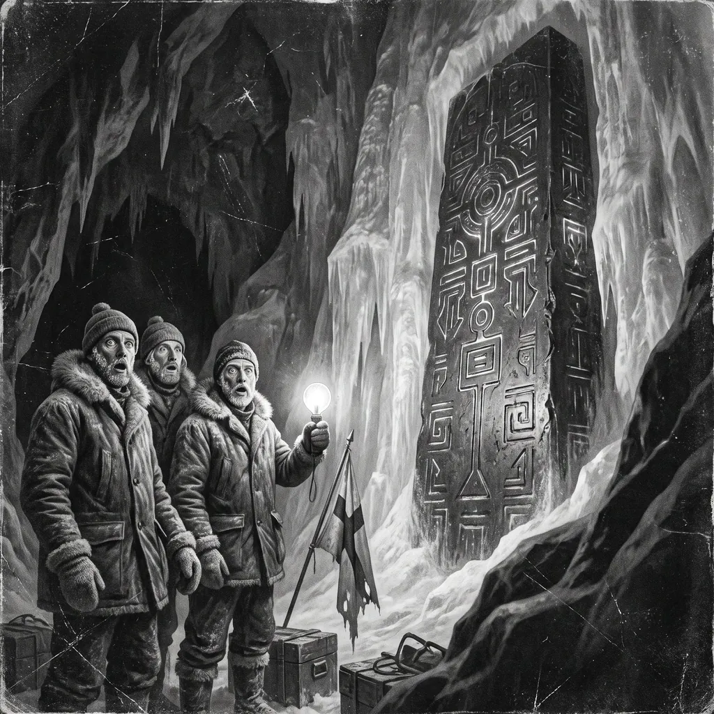

# 1923 Antarctic Expedition Archive Photo — by @elio_ia

[← Back to Community Examples](../../EXAMPLES.md) · Category: Photography · Model: `Nano Banana Pro`

<a href="https://x.com/elio_ia/status/2104929448155844935"></a>

Source: **[@elio_ia on X](https://x.com/elio_ia/status/2104929448155844935)** · Creator: [Elian Iao](https://x.com/elio_ia)

## Prompt

```text
Raw archival black and white photograph from a 1923 Antarctic expedition, grain, scratches, flash illumination. Weary explorers bundled in vintage heavy winter coats staring in shock at a massive, intricate glowing metallic monolith partially frozen inside a sheer ice cavern, photorealistic, historical documentary photography, hyper-detailed textures.
```

## Try it

Paste the prompt into **[vinano.ai](https://vinano.ai?utm_source=github&utm_medium=readme&utm_campaign=awesome-image-video-prompts-updating&utm_content=x-page-try)** to generate your own version.

> The image and prompt belong to @elio_ia ([original post](https://x.com/elio_ia/status/2104929448155844935)) and are shown here with credit for reference. Creators can ask for changes or removal by opening an issue.
