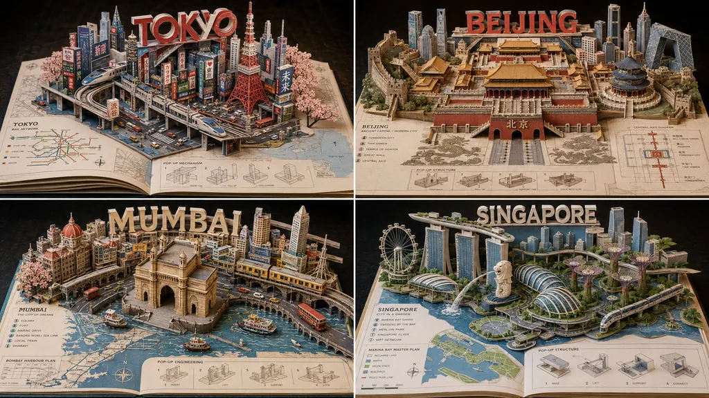

# Pop-Up Book City Dioramas — by @Gdgtify

[← Back to Community Examples](../../EXAMPLES.md) · Category: Illustration & 3D · Model: `Nano Banana`

<a href="https://x.com/Gdgtify/status/2082221056652443680"></a>

Source: **[@Gdgtify on X](https://x.com/Gdgtify/status/2082221056652443680)** · Creator: [Gadgetify](https://x.com/Gdgtify)

## Prompt

```text
2x2 grid, 16:9, do this for 4 important Asian cities: Generate a photoreal miniature pop-up book diorama for [SUBJECT].Rules:- infer SUBJECT_DNA automatically- use BASE_DOCUMENT as the physical foundation- the subject must rise from the page as a paper-engineered 3D world- include inferred landmarks, architecture, terrain, infrastructure, cultural motifs, and small scale cues- show folded platforms, stairs, slots, hinges, support struts, and hidden paper mechanics- integrate the subject name or symbolic typography as raised paper letters or structural forms- the base page should contain an inferred map, diagram, blueprint, or printed context relevant to SUBJECT- everything must feel crafted from paper, cardstock, ink, miniature model materials, and precise pop-up engineering- no hard-coded city, landmark, tower, temple, map, color, or text unless supplied
```

## Try it

Paste the prompt into **[vinano.ai](https://vinano.ai?utm_source=github&utm_medium=readme&utm_campaign=awesome-image-video-prompts-updating&utm_content=x-page-try)** to generate your own version.

> The image and prompt belong to @Gdgtify ([original post](https://x.com/Gdgtify/status/2082221056652443680)) and are shown here with credit for reference. Creators can ask for changes or removal by opening an issue.
