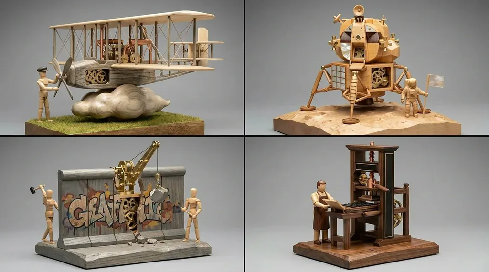

# Kinetic Sculpture History Grid — by @Gdgtify

[← Back to Community Examples](../../EXAMPLES.md) · Category: Illustration & 3D · Model: `Nano Banana`

<a href="https://x.com/Gdgtify/status/2095854642882019392"></a>

Source: **[@Gdgtify on X](https://x.com/Gdgtify/status/2095854642882019392)** · Creator: [Gadgetify](https://x.com/Gdgtify)

## Prompt

```text
2x2 grid, 16:9, do this for 4 most important events in history: <instruction>  
  1. The Semantic Inference Engine (Dynamic Material Mapping):  
Input A is ANY Topic (Object, Animal, Plant, or Concept).
Analyze the subject's inherent properties and map them to   Artisanal Materials  :
   The Primary Body (The Chassis):  Infer the subject's main color/weight and assign a corresponding   Hardwood  .
   (e.g., If 'Elephant' -> Grey/Heavy -> Weathered Oak. If 'Ferrari' -> Red/Fast -> Polished Padauk or Rosewood. If 'Swan' -> White/Light -> Bleached Ash or Holly). 
   The Accents (The Inlay):  Infer the subject's patterns or details and assign a contrasting   Marquetry Material  .
   (e.g., Stripes -> Ebony inlay. Windows -> Mother of Pearl. Spots -> Burl wood knots). 
   The Mechanics (The Skeleton):  Infer the subject's joints or power source and assign   Metal Hardware  .
   (e.g., Muscles/Pistons -> Copper Hydraulics. Brain/Computer -> Brass Gears. Eyes/Sensors -> Convex Glass Lenses). 
2. The "Immutable" Container (The Automaton):
Goal: A "Da Vinci Workshop" Product Shot.
The Object: The subject is rendered as a complex, freestanding Wooden Mechanical Toy.
The Base: The model stands on a hand-carved wooden block representing its semantic environment.
(e.g., A Wooden Wave for a Fish, A Wooden Cloud for a Bird, A Cobblestone block for a Car).
The Scale: Macro photography of a tabletop object (approx. 12 inches tall).
3. The Clockwork Interior (The Transformation):
The Cutaway: A section of the outer "wood shell" is visually removed or hinged open.
The Guts: Inside, the biological or mechanical inner workings are replaced by Clockwork Mechanics.
Rule: Visible gears, bicycle chains, watch springs, and brass flywheels must imply the object moves via wind-up power.
The Fasteners: Tiny brass screws, rivets, and hinges are visible along the seams of the wood.
4. The Narrative Figure (The Operator):
The Character: A standard Jointed Wooden Mannequin (Artist's Doll style) is integrated into the scene.
The Role: The figure acts as the maintainer, rider, or operator of the subject.
Interaction: They are climbing a ladder to polish the object, turning a giant wind-up key, or steering the beast/machine.
The Accessories: The doll wears carved wooden gear appropriate to the context (e.g., A cowboy hat for a Horse, A welding mask for a Robot).
5. Lighting & Atmosphere:
Lighting: Softbox Studio Lighting. Diffused, high-end commercial lighting that creates long, elegant highlights on the varnished curves.
Background: Neutral Studio Grey. Seamless infinity backdrop to focus entirely on the material textures.
Texture: High Gloss Varnish. The wood must look expensive, smooth, and deeply saturated.
Output: ONE image, 1:1 Aspect Ratio, Product Photography, "Woodpunk" aesthetic, 8k Resolution.
</instruction>
```

## Try it

Paste the prompt into **[vinano.ai](https://vinano.ai?utm_source=github&utm_medium=readme&utm_campaign=awesome-image-video-prompts-updating&utm_content=x-page-try)** to generate your own version.

> The image and prompt belong to @Gdgtify ([original post](https://x.com/Gdgtify/status/2095854642882019392)) and are shown here with credit for reference. Creators can ask for changes or removal by opening an issue.
