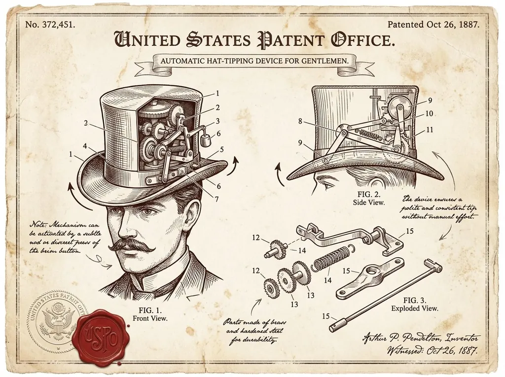

# Vintage Patent Document — by @AllaAisling

[← Back to Community Examples](../../EXAMPLES.md) · Category: Poster Design · Model: `Nano Banana`

<a href="https://x.com/AllaAisling/status/2004212035333365763"></a>

Source: **[@AllaAisling on X](https://x.com/AllaAisling/status/2004212035333365763)** · Creator: [Alexandra Aisling](https://x.com/AllaAisling)

## Prompt

```text
A vintage patent document for [INVENTION], styled after late 1800s United States Patent Office filings. The page features precise technical drawings with numbered callouts (Fig. 1, Fig. 2, Fig. 3) showing front, side, and exploded views. Handwritten annotations in fountain-pen ink describe mechanisms. The paper is aged ivory with foxing stains and soft fold creases. An official embossed seal and red wax stamp appear in the corner. A hand-signed inventor's name and date appear at the bottom. The entire image feels like a recovered archival document—authoritative, historic, and slightly mysterious.
```

## Try it

Paste the prompt into **[vinano.ai](https://vinano.ai?utm_source=github&utm_medium=readme&utm_campaign=awesome-image-video-prompts-updating&utm_content=x-page-try)** to generate your own version.

> The image and prompt belong to @AllaAisling ([original post](https://x.com/AllaAisling/status/2004212035333365763)) and are shown here with credit for reference. Creators can ask for changes or removal by opening an issue.
