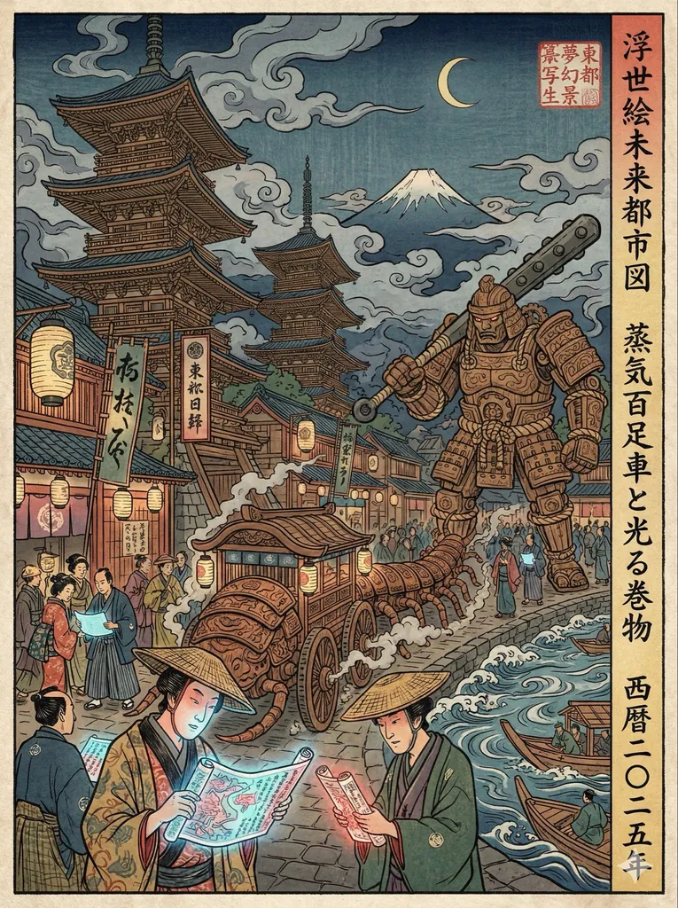

# Edo Ukiyo-e Future City — by @VoxcatAI

[← Back to Community Examples](../../EXAMPLES.md) · Category: Illustration & 3D · Model: `Unknown`

<a href="https://x.com/VoxcatAI/status/1995497350543110411"></a>

Source: **[@VoxcatAI on X](https://x.com/VoxcatAI/status/1995497350543110411)** · Creator: [VoxCat](https://x.com/VoxcatAI)

## Prompt

```text
# Core Style & Theme (核心风格与主题)
A Japanese Edo-period Ukiyo-e woodblock print (浮世絵 木版画). The overall feeling is a surreal collaboration between masters like Hokusai and Hiroshige, reimagining modern technology through an ancient lens.

# Scene Concept & Anachronism Fusion (场景概念与时代错置融合)
**The Scene:** [在这里写你的现代场景，例如：繁忙的涩谷十字路口 / 东京地铁通勤早高峰 / 赛博朋克风格的城市夜景]

**Edo Transformation Logic:**
Characters wear Edo-era kimono but perform modern actions. All technology is transformed into surreal Edo equivalents:
* **Smartphones** are glowing, illustrated paper scrolls being read intently.
* **Metro stations/Trains** are giant articulated wooden centipede carriages shuffling through crowds.
* **Skyscrapers** are reimagined as endless, towering wooden pagodas reaching into dramatic clouds.
* **Robots/Mecha** appear as giant, armored woodblock golems.

# Artistic Direction & Composition (艺术指导与构图)
The composition uses a flattened perspective with large, bold, hand-carved ink outlines (太い墨線). The background features heavily stylized Ukiyo-e wave patterns and dramatic, swirling clouds, with a distant Mt. Fuji visible on the horizon.

# Texture, Materiality & Color (纹理、材质与色彩)
The image must look like a physical print, not a digital painting.
* **Texture:** Strong visible wood grain texture (木目) and rough paper fibers throughout the piece.
* **Printing Imperfections:** Pigment bleeding is evident. Crucially, simulate hand-pressed plates with slight **color misalignment (版ズレ)** for authenticity.
* **Color Palette:** Strictly limited to traditional mineral pigments. Dominant use of Prussian blue (浮世絵ブルー), vermilion red, and muted yellow ochre.
* **Lighting:** Soft, flat, shadow-free lighting with no digital gradients.

# Technical Specs & Details (技术规格与细节)
* **Aspect Ratio:** 3:4 vertical poster.
* **Extras:** Include vertical Japanese calligraphy describing the scene and a traditional red artist seal stamp (落款) in a corner.
```

## Try it

Paste the prompt into **[vinano.ai](https://vinano.ai?utm_source=github&utm_medium=readme&utm_campaign=awesome-image-video-prompts-updating&utm_content=x-page-try)** to generate your own version.

> The image and prompt belong to @VoxcatAI ([original post](https://x.com/VoxcatAI/status/1995497350543110411)) and are shown here with credit for reference. Creators can ask for changes or removal by opening an issue.
