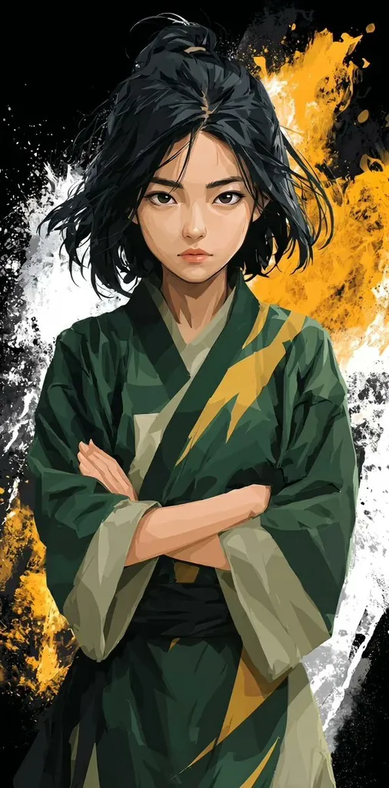

# Martial Arts Anime Girl — by @lovimg_com

[← Back to Community Examples](../../EXAMPLES.md) · Category: Illustration & 3D · Model: `Nano Banana Pro`

<a href="https://x.com/lovimg_com/status/2096954809534570766"></a>

Source: **[@lovimg_com on X](https://x.com/lovimg_com/status/2096954809534570766)** · Creator: [lovimg_com](https://x.com/lovimg_com)

## Prompt

```text
A stylized digital anime illustration of a young East Asian girl with a serious, determined expression, standing with arms crossed over her chest. She has messy, short black hair tied partially into a loose topknot bun with stray strands framing her face, dark expressive eyes, and fair skin. She wears a loose, oversized dark forest-green martial arts kimono robe with light sage inner lining, wide folded cuffs, a black sash (obi) tied at the waist, and striking yellow-gold lightning bolt patterns across the chest. Dynamic ink splatter background in bold black, white, and vivid warm yellow-orange hues, vector art meets comic book illustration style, cel shading, sharp outlines, painterly brush strokes, dramatic lighting, high contrast, vertical portrait --ar 1:2 --v 6.0
```

## Try it

Paste the prompt into **[vinano.ai](https://vinano.ai?utm_source=github&utm_medium=readme&utm_campaign=awesome-image-video-prompts-updating&utm_content=x-page-try)** to generate your own version.

> The image and prompt belong to @lovimg_com ([original post](https://x.com/lovimg_com/status/2096954809534570766)) and are shown here with credit for reference. Creators can ask for changes or removal by opening an issue.
