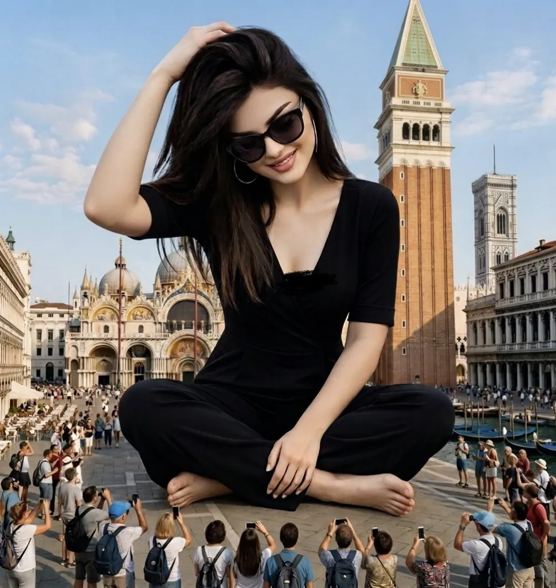

# Giant Woman in Piazza San Marco — by @Its_shah2i0

[← Back to Community Examples](../../EXAMPLES.md) · Category: Photography · Model: `Nano Banana`

<a href="https://x.com/Its_shah2i0/status/2072340606400045317"></a>

Source: **[@Its_shah2i0 on X](https://x.com/Its_shah2i0/status/2072340606400045317)** · Creator: [HiBå🫰](https://x.com/Its_shah2i0)

## Prompt

```text
A surreal giant woman sitting gracefully in the middle of Venice's Piazza San Marco, wearing an elegant black outfit and sunglasses, smiling softly while tourists gather around taking photos with their phones. Cinematic lighting, realistic architecture, dramatic scale contrast, ultra-detailed, photorealistic, travel photography, vibrant sky, natural shadows, high realism, 8K.
```

## Try it

Paste the prompt into **[vinano.ai](https://vinano.ai?utm_source=github&utm_medium=readme&utm_campaign=awesome-image-video-prompts-updating&utm_content=x-page-try)** to generate your own version.

> The image and prompt belong to @Its_shah2i0 ([original post](https://x.com/Its_shah2i0/status/2072340606400045317)) and are shown here with credit for reference. Creators can ask for changes or removal by opening an issue.
