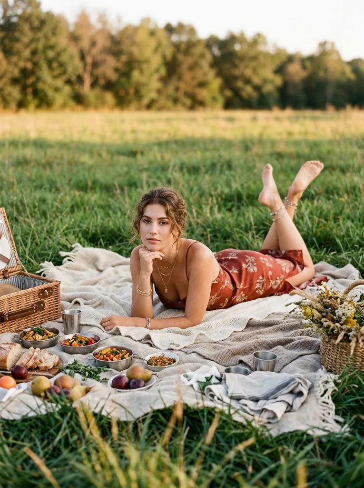

# Picnic Fashion Editorial — by @dreamydigiarts

[← Back to Community Examples](../../EXAMPLES.md) · Category: Photography · Model: `Nano Banana 2`

<a href="https://x.com/dreamydigiarts/status/2095731078979813473"></a>

Source: **[@dreamydigiarts on X](https://x.com/dreamydigiarts/status/2095731078979813473)** · Creator: [dreamy digital arts](https://x.com/dreamydigiarts)

## Prompt

```text
Create a warm late-afternoon fashion editorial built around an abundant picnic spread in a quiet grassy field bordered by distant trees. Layer oversized cream and taupe blankets loosely across the grass, rumpled rather than perfectly arranged.  An adult woman lies comfortably on her stomach across the center of the blankets, body extending horizontally through the frame. She props herself on both forearms with one hand lightly supporting her chin. Bend both lower legs upward behind her at slightly different angles for a relaxed, spontaneous silhouette. She looks directly toward the camera with calm confidence.  Dress her in a fitted rust-red silk midi dress with a muted botanical print, narrow straps, a softly shaped neckline and a high side slit that allows the fabric to fall naturally around the bent leg. Keep the silhouette close through the waist and hips rather than loose or bohemian. Add layered delicate gold necklaces, bracelets and anklets. Style her hair in a loose low updo with soft curls escaping around the face.  Build a substantial picnic around her without making it pristine: an open wicker hamper, small metal serving bowls containing colorful savory dishes, bread, fruit, herbs, drinking cups, folded textiles and a woven basket of dried flowers. Keep the food clustered mostly across the foreground and sides, clearly separate from her body.  Shoot vertically from slightly above blanket height with her face sharp and the foreground spread creating depth. Use soft golden natural light, subdued greens, warm rust, cream, silver and wicker tones, gentle film grain and modest depth of field. The final image should feel abundant, languid and quietly glamorous, like an afternoon that has stretched much longer than intended.
```

## Try it

Paste the prompt into **[vinano.ai](https://vinano.ai?utm_source=github&utm_medium=readme&utm_campaign=awesome-image-video-prompts-updating&utm_content=x-page-try)** to generate your own version.

> The image and prompt belong to @dreamydigiarts ([original post](https://x.com/dreamydigiarts/status/2095731078979813473)) and are shown here with credit for reference. Creators can ask for changes or removal by opening an issue.
