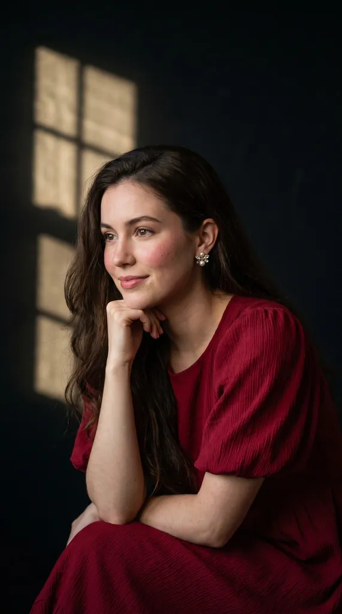

# Crimson Dress Window-Light Portrait — by @LettyVesper

[← Back to Community Examples](../../EXAMPLES.md) · Category: Photography · Model: `Nano Banana Pro`

<a href="https://x.com/LettyVesper/status/2112553939312820295"></a>

Source: **[@LettyVesper on X](https://x.com/LettyVesper/status/2112553939312820295)** · Creator: [Letty](https://x.com/LettyVesper)

## Prompt

```text
Cinematic portrait of a young woman with long, silky dark brown hair, sitting and resting her chin on her hand, gazing softly off to the side with a gentle smile. She wears a deep crimson red flowy dress with puffed sleeves and a textured, crinkled fabric. Small floral pearl-and-crystal stud earrings. Dramatic low-key lighting: a single warm window light casting geometric window-shadow patterns on a dark wall, soft glow on her face, deep black background. Rosy cheeks, soft natural makeup, dreamy and romantic mood. Shallow depth of field, 85mm lens, ultra-detailed skin texture, rich contrast, moody studio photography, vertical 9:16
```

## Try it

Paste the prompt into **[vinano.ai](https://vinano.ai?utm_source=github&utm_medium=readme&utm_campaign=awesome-image-video-prompts-updating&utm_content=x-page-try)** to generate your own version.

> The image and prompt belong to @LettyVesper ([original post](https://x.com/LettyVesper/status/2112553939312820295)) and are shown here with credit for reference. Creators can ask for changes or removal by opening an issue.
