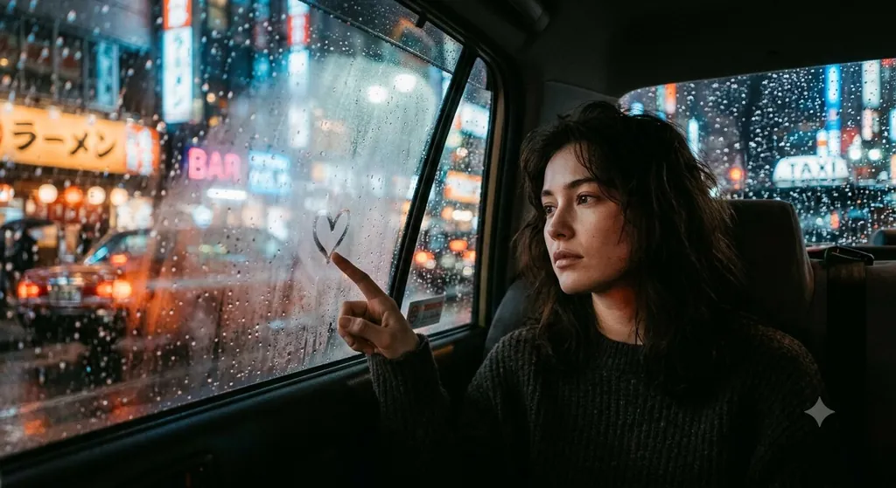

# Rainy Night Car Window Portrait — by @SheBuildsAI_

[← Back to Community Examples](../../EXAMPLES.md) · Category: Photography · Model: `Nano Banana Pro`

<a href="https://x.com/SheBuildsAI_/status/2096282220931822061"></a>

Source: **[@SheBuildsAI_ on X](https://x.com/SheBuildsAI_/status/2096282220931822061)** · Creator: [Compound Learning - Tech | Science](https://x.com/SheBuildsAI_)

## Prompt

```text
{
  "title": "Cinematic Rainy Night Portrait",

  "description": "An emotional cinematic portrait captured through a fogged and rain-covered car window during a rainy night in a neon-lit city. A beautiful young woman sits alone in the backseat, quietly looking outside with a distant and melancholic expression. She gently draws a small heart on the misted glass while colorful city lights blur behind the raindrops, creating a feeling of loneliness, nostalgia, and quiet reflection.",

  "prompt": "A cinematic rainy-night portrait photographed through a fogged and rain-covered car window. A beautiful young woman sits alone in the backseat of a car during heavy rain, gazing outside with a distant, melancholic expression. She gently draws a tiny heart on the misted glass with her finger. Raindrops stream down the window, distorting colorful city lights and neon signs in the background. Soft blue and warm orange neon reflections illuminate her face and the wet glass. Emotional solitude, quiet sadness, cinematic storytelling, realistic skin texture, visible pores, natural makeup, slightly messy hair, expressive eyes, shallow depth of field, dreamy bokeh, soft focus falloff, realistic reflections, atmospheric lighting, analog film grain, cinematic color grading, photorealistic, masterpiece photography, ultra-detailed, 85mm lens, f/1.4, award-winning portrait, emotional visual poetry, 8k.",

  "style": [
    "cinematic photography",
    "photorealistic",
    "analog film aesthetic",
    "emotional visual storytelling",
    "neo-noir atmosphere"
  ],

  "negative_prompt": "anime, cartoon, CGI, 3D render, low quality, blurry face, extra fingers, bad anatomy, unrealistic skin, oversaturated colors, watermark, text, logo, duplicate person, distorted hands, plastic skin"
}
```

## Try it

Paste the prompt into **[vinano.ai](https://vinano.ai?utm_source=github&utm_medium=readme&utm_campaign=awesome-image-video-prompts-updating&utm_content=x-page-try)** to generate your own version.

> The image and prompt belong to @SheBuildsAI_ ([original post](https://x.com/SheBuildsAI_/status/2096282220931822061)) and are shown here with credit for reference. Creators can ask for changes or removal by opening an issue.
