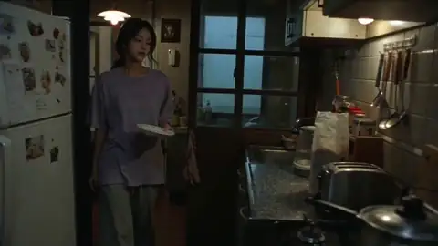

# Rainy Seoul Breakfast ASMR — by @iamahmedfaraz66

[← Back to Community Examples](../../EXAMPLES.md) · Category: Video · Model: `Seedance 2.0`

<a href="https://x.com/iamahmedfaraz66/status/2124518482918486393"></a>

**[▶ Watch the full video on X](https://x.com/iamahmedfaraz66/status/2124518482918486393)** — the preview above is a short silent clip.

Source: **[@iamahmedfaraz66 on X](https://x.com/iamahmedfaraz66/status/2124518482918486393)** · Creator: [Ahmad Faraz](https://x.com/iamahmedfaraz66)

## Prompt

```text
Create a 15-second ultra-photorealistic cinematic 16:9 lifestyle video set in a cozy Seoul apartment during a rainy early morning. A beautiful young Korean woman with long dark hair, wearing an oversized comfortable sweatshirt, prepares a delicious breakfast sandwich beside a large rain-covered kitchen window.

Begin with atmospheric shots of quiet Seoul streets, misty buildings and raindrops sliding down the glass. Transition to detailed close-ups of her hands spreading butter on fresh bread, frying an egg, slicing tomatoes and layering lettuce, cheese and egg. Toast the sandwich until golden and crispy, then slice it diagonally, revealing the delicious filling.

She carries the sandwich to the window, sits comfortably with a steaming cup of coffee and takes a slow, satisfying bite. Capture her subtle smile as she watches the rainy city outside.

**Visuals:** Authentic Korean apartment, soft blue-grey dawn lighting, warm kitchen ambience, beautiful food cinematography, natural skin textures, shallow depth of field, smooth camera movements and realistic human motion.

**Audio:** Immersive ASMR of rainfall, frying egg, knife chopping, bread crunching, coffee pouring and gentle eating sounds. No dialogue, no background music, no subtitles. Maintain consistent character appearance and cinematic continuity throughout.
```

## Try it

Paste the prompt into **[vinano.ai](https://vinano.ai?utm_source=github&utm_medium=readme&utm_campaign=awesome-image-video-prompts-updating&utm_content=x-page-try)** to generate your own version.

> The video and prompt belong to @iamahmedfaraz66 ([original post](https://x.com/iamahmedfaraz66/status/2124518482918486393)) and are shown here with credit for reference. Creators can ask for changes or removal by opening an issue.
