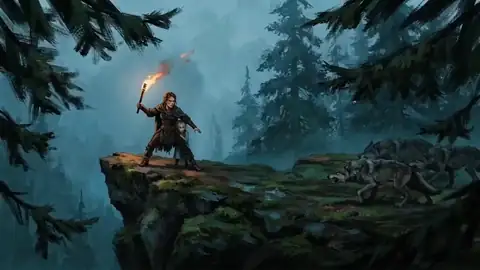

# Torch Against the Wolf Pack — by @CodesWithAli

[← Back to Community Examples](../../EXAMPLES.md) · Category: Video · Model: `Seedance 2.0`

<a href="https://x.com/CodesWithAli/status/2124166885826871631"></a>

**[▶ Watch the full video on X](https://x.com/CodesWithAli/status/2124166885826871631)** — the preview above is a short silent clip.

Source: **[@CodesWithAli on X](https://x.com/CodesWithAli/status/2124166885826871631)** · Creator: [Ali](https://x.com/CodesWithAli)

## Prompt

```text
Create a cinematic 3D animated fantasy adventure scene in a dark, mysterious forest at dusk. A brave young medieval woman holding a burning torch is protecting a small blonde girl from a pack of aggressive grey wolves. The wolves slowly surround them, growling, showing their sharp teeth and preparing to attack. The woman holds the child close with one arm and raises the flaming torch with the other hand to scare away the wolves.

Show dramatic action sequences with wolves running, jumping and approaching from different directions. The woman courageously steps backward while protecting the frightened child. Add realistic torch flames, glowing embers, smoke, wind moving their clothes and hair, and dense pine trees in the background.

Use cinematic camera movements, dramatic close-ups, wide-angle forest shots, low-angle wolf shots and smooth transitions. Highly detailed 3D animated characters, realistic facial expressions, professional fantasy movie animation, atmospheric blue lighting, dramatic shadows, ultra-detailed environment, 4K quality, 16:9 widescreen.

Maintain consistent character appearances throughout the video. Make the action suspenseful, emotional and engaging. End with a mysterious cliffhanger showing the wolves surrounding the woman and child.
```

## Try it

Paste the prompt into **[vinano.ai](https://vinano.ai?utm_source=github&utm_medium=readme&utm_campaign=awesome-image-video-prompts-updating&utm_content=x-page-try)** to generate your own version.

> The video and prompt belong to @CodesWithAli ([original post](https://x.com/CodesWithAli/status/2124166885826871631)) and are shown here with credit for reference. Creators can ask for changes or removal by opening an issue.
