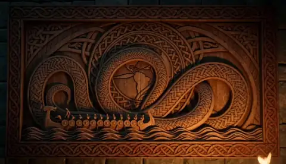

# Norse Wood Carving Serpent — by @AllaAisling

[← Back to Community Examples](../../EXAMPLES.md) · Category: Video · Model: `Seedance 2.0`

<a href="https://x.com/AllaAisling/status/2124278684710482420"></a>

**[▶ Watch the full video on X](https://x.com/AllaAisling/status/2124278684710482420)** — the preview above is a short silent clip.

Source: **[@AllaAisling on X](https://x.com/AllaAisling/status/2124278684710482420)** · Creator: [Alexandra Aisling](https://x.com/AllaAisling)

## Prompt

```text
Animated Norse wood carving relief, weathered oak grain, carved grooves and interlacing knotwork that slides and reweaves as things move, faded red ochre and black paint, raking firelight casting deep shadows. Color grade: warm oak brown, faded red ochre, black, firelight amber.

SUBJECT: A colossal world serpent coiled in knotwork around the earth, a fierce carved head biting its own tail. A longship with round shields, a dragon prow and a crew of warriors at the oars.

SHOT 1 (0 to 3s): Wide shot, firelight flickers across the carving and the serpent's knotwork body begins to slide and reweave itself around the earth.

SHOT 2 (3 to 6s): Medium shot, 35mm lens, the longship rows across carved waves, warriors straining at their oars, the dragon prow rising and falling.

SHOT 3 (6 to 9s): Close-up, 85mm lens, the serpent's carved jaw slowly releases its own tail, wood creaking and splintering, its eye a deep groove glowing red.

SHOT 4 (9 to 12s): Low angle wide shot, 20mm lens, the serpent's head rises out of the carved sea beside the longship, coils lifting in a tidal wave of grooved water.

SHOT 5 (12 to 15s): Extreme wide shot, 16mm lens, the warriors raise their shields together, the serpent coils back around the earth and bites its tail again, and the runes around the border glow.

AUDIO: Crackling hearth fire, creaking wood, oar strokes and a rowing chant, carved wood grinding and splintering, a deep hissing roar, shields clashing, frame drum and throat singing.
```

## Try it

Paste the prompt into **[vinano.ai](https://vinano.ai?utm_source=github&utm_medium=readme&utm_campaign=awesome-image-video-prompts-updating&utm_content=x-page-try)** to generate your own version.

> The video and prompt belong to @AllaAisling ([original post](https://x.com/AllaAisling/status/2124278684710482420)) and are shown here with credit for reference. Creators can ask for changes or removal by opening an issue.
