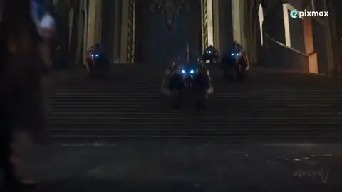

# Lightning Queen in the Castle — by @draavenai

[← Back to Community Examples](../../EXAMPLES.md) · Category: Video · Model: `Seedance 2.0`

<a href="https://x.com/draavenai/status/2124422089490973066"></a>

**[▶ Watch the full video on X](https://x.com/draavenai/status/2124422089490973066)** — the preview above is a short silent clip.

Source: **[@draavenai on X](https://x.com/draavenai/status/2124422089490973066)** · Creator: [Draaven](https://x.com/draavenai)

## Prompt

```text
A powerful fantasy queen warrior with long silver-white hair and a magnificent golden crown stands fearlessly inside a massive ancient royal castle. She wears elegant black and silver battle armor with glowing blue magical energy surrounding her hands. Behind her, dozens of mysterious dark armored warriors with glowing electric-blue eyes surround the royal courtyard. Suddenly, the queen raises her hands and unleashes an enormous wave of blue lightning magic. The entire castle trembles as powerful electrical energy spreads across the battlefield. Dark storm clouds gather above the kingdom, lightning strikes the castle towers, and magical energy illuminates the night sky. Epic fantasy atmosphere, breathtaking cinematic camera movements, realistic lightning effects, ultra-detailed 3D CGI, dramatic lighting, 4K movie quality.
```

## Try it

Paste the prompt into **[vinano.ai](https://vinano.ai?utm_source=github&utm_medium=readme&utm_campaign=awesome-image-video-prompts-updating&utm_content=x-page-try)** to generate your own version.

> The video and prompt belong to @draavenai ([original post](https://x.com/draavenai/status/2124422089490973066)) and are shown here with credit for reference. Creators can ask for changes or removal by opening an issue.
