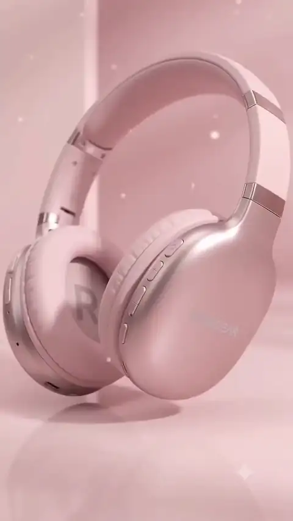

# Rose-Gold Headphones Product Ad — by @AIwithRubii

[← Back to Community Examples](../../EXAMPLES.md) · Category: Video · Model: `Seedance 2.0`

<a href="https://x.com/AIwithRubii/status/2124412528348586165"></a>

**[▶ Watch the full video on X](https://x.com/AIwithRubii/status/2124412528348586165)** — the preview above is a short silent clip.

Source: **[@AIwithRubii on X](https://x.com/AIwithRubii/status/2124412528348586165)** · Creator: [Rubi](https://x.com/AIwithRubii)

## Prompt

```text
Create a luxurious cinematic 3D product advertisement featuring elegant rose-gold pink over-ear wireless headphones. Begin with a close-up shot showing the headphones' premium design, then smoothly reveal their internal components with a futuristic holographic disassembly effect. Add glowing blue energy particles and magical light trails as the components assemble back together. Transition into beautiful rotating product shots from multiple angles, highlighting the ear cushions, headband, and sleek finish. Soft blush-pink studio background, glossy reflective floor, sparkling particles, elegant lighting, ultra-realistic materials, smooth camera movements, premium commercial aesthetic, 4K quality.
```

## Try it

Paste the prompt into **[vinano.ai](https://vinano.ai?utm_source=github&utm_medium=readme&utm_campaign=awesome-image-video-prompts-updating&utm_content=x-page-try)** to generate your own version.

> The video and prompt belong to @AIwithRubii ([original post](https://x.com/AIwithRubii/status/2124412528348586165)) and are shown here with credit for reference. Creators can ask for changes or removal by opening an issue.
