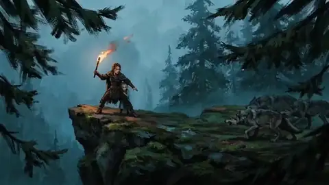

# Warrior and Child in the Wolf Forest — by @draavenai

[← Back to Community Examples](../../EXAMPLES.md) · Category: Video · Model: `Seedance 2.0`

<a href="https://x.com/draavenai/status/2124003994762903950"></a>

**[▶ Watch the full video on X](https://x.com/draavenai/status/2124003994762903950)** — the preview above is a short silent clip.

Source: **[@draavenai on X](https://x.com/draavenai/status/2124003994762903950)** · Creator: [Draaven](https://x.com/draavenai)

## Prompt

```text
A cinematic dark fantasy adventure in a mysterious ancient forest at night. A brave young female warrior with long brown hair, wearing a dark green medieval cloak, protects a frightened little child from a pack of terrifying grey wolves. She holds a burning torch in one hand while standing fearlessly between the child and the approaching wolves. The wolves surround them in the foggy forest, their glowing eyes watching every movement. The warrior raises her torch, creating a magical circle of fire around them. Suddenly, the wolves leap forward as she prepares to defend the child. Dramatic moonlight, dense forest mist, emotional storytelling, detailed character expressions, cinematic camera angles, realistic fire effects, dark fantasy animation, ultra-detailed 3D visuals, 4K quality.
```

## Try it

Paste the prompt into **[vinano.ai](https://vinano.ai?utm_source=github&utm_medium=readme&utm_campaign=awesome-image-video-prompts-updating&utm_content=x-page-try)** to generate your own version.

> The video and prompt belong to @draavenai ([original post](https://x.com/draavenai/status/2124003994762903950)) and are shown here with credit for reference. Creators can ask for changes or removal by opening an issue.
