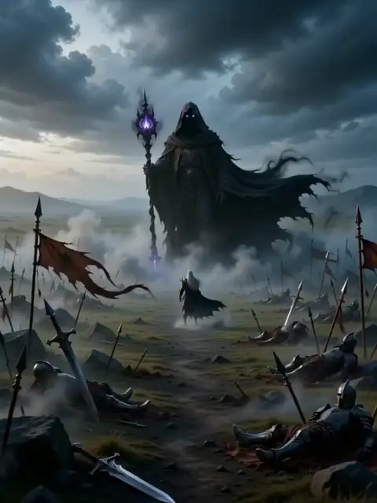

# The Sorcerer Who Challenged Death — by @DeCat2025

[← Back to Community Examples](../../EXAMPLES.md) · Category: Video · Model: `PixVerse 6.0`

<a href="https://x.com/DeCat2025/status/2123994151016443982"></a>

**[▶ Watch the full video on X](https://x.com/DeCat2025/status/2123994151016443982)** — the preview above is a short silent clip.

Source: **[@DeCat2025 on X](https://x.com/DeCat2025/status/2123994151016443982)** · Creator: [DeCat](https://x.com/DeCat2025)

## Prompt

```text
DURATION: 15 seconds | 16:9 widescreen
STYLE: Ultra-photorealistic Hollywood live-action dark fantasy, monumental supernatural warfare, ancient forbidden magic, breathtaking cinematic scale.

MAIN CHARACTER:
A legendary immortal sorcerer with long silver-black hair, piercing golden eyes, an ancient obsidian crown, and intricately engraved black-and-gold armor. Regal, fearless, commanding. Natural skin texture, realistic hair and weathered armor.

0-3s | THE FINAL CHALLENGE:
Extreme-wide aerial shot of a vast ancient battlefield covered in abandoned armor, swords, and shattered banners beneath storm clouds. The sorcerer stands alone facing Death, a towering spectral figure wearing an enormous dark cloak and holding a magnificent obsidian staff. Dramatic low-angle close-up reveals the sorcerer's unwavering golden eyes.

3-6s | THE FORBIDDEN GATES:
The sorcerer raises both hands. Gigantic rotating golden runes illuminate the ground. An enormous ancient stone gateway emerges from the mist, its monumental doors opening to reveal a swirling realm of silver-blue celestial energy. The spectral guardian raises its staff as violet lightning fills the sky.

6-10s | THE LEGION AWAKENS:
Spectacular ground-level tracking shot. Thousands of magnificent spectral knights emerge through the gateway, wearing ancient translucent armor and carrying luminous swords. Enormous ghostly warhorses and colossal armored spectral guardians follow. The sorcerer levitates above the army, commanding their formation with one raised hand.

10-15s | THE IMMORTAL KING:
Extreme-wide cinematic shot. The spectral knights charge across the battlefield as the towering guardian unleashes a gigantic violet magical wave. The sorcerer counters with a colossal golden shield, creating an immense luminous shockwave. Final aerial pullback reveals the immortal sorcerer suspended above his vast spectral legion, the enormous gateway blazing behind him.

CINEMATOGRAPHY:
Premium large-format live-action realism, dramatic low angles, sweeping aerial tracking, expressive close-ups, weathered armor, realistic spectral translucency, volumetric fog, physically convincing magical light, cinematic gold-blue grading, monumental scale.

AUDIO:
Deep supernatural thunder, ancient stone gates rumbling, spectral cavalry, magical resonance, colossal energy impacts, powerful orchestral crescendo. No dialogue.

CONTINUITY:
One immortal sorcerer, one towering spectral guardian, one ancient gateway, one spectral army. Consistent character design, magical colors, battlefield geography, and spectral effects.

AVOID:
Graphic violence, injuries, disturbing imagery, cartoon aesthetics, plastic CGI, distorted faces, extra limbs, duplicate characters, excessive neon, chaotic editing, text, logos, watermarks.
```

## Try it

Paste the prompt into **[vinano.ai](https://vinano.ai?utm_source=github&utm_medium=readme&utm_campaign=awesome-image-video-prompts-updating&utm_content=x-page-try)** to generate your own version.

> The video and prompt belong to @DeCat2025 ([original post](https://x.com/DeCat2025/status/2123994151016443982)) and are shown here with credit for reference. Creators can ask for changes or removal by opening an issue.
