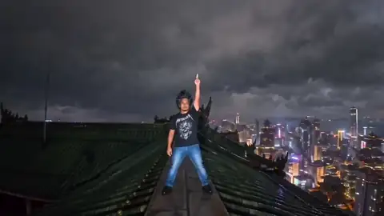

# Rooftop Storm Caller — by @draavenai

[← Back to Community Examples](../../EXAMPLES.md) · Category: Video · Model: `Seedance 2.0`

<a href="https://x.com/draavenai/status/2124165725124182182"></a>

**[▶ Watch the full video on X](https://x.com/draavenai/status/2124165725124182182)** — the preview above is a short silent clip.

Source: **[@draavenai on X](https://x.com/draavenai/status/2124165725124182182)** · Creator: [Draaven](https://x.com/draavenai)

## Prompt

```text
A cinematic superhero scene featuring a young man standing fearlessly on the rooftop of a traditional Asian building overlooking a breathtaking futuristic city at night. Dark storm clouds cover the sky as powerful lightning strikes directly into his raised hand. His hand glows with intense blue-white electrical energy, creating a spectacular lightning beam stretching from the sky to his fingertips. He then extends his arm toward the glowing city, releasing a powerful electric energy wave. Skyscrapers illuminate the night, dramatic thunderstorm effects, realistic lightning, cinematic camera movements, epic superhero atmosphere, ultra-realistic VFX, 4K quality.
```

## Try it

Paste the prompt into **[vinano.ai](https://vinano.ai?utm_source=github&utm_medium=readme&utm_campaign=awesome-image-video-prompts-updating&utm_content=x-page-try)** to generate your own version.

> The video and prompt belong to @draavenai ([original post](https://x.com/draavenai/status/2124165725124182182)) and are shown here with credit for reference. Creators can ask for changes or removal by opening an issue.
