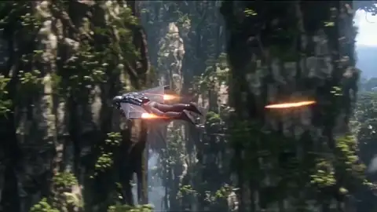

# Canyon Wingsuit Drone Chase — by @DeCat2025

[← Back to Community Examples](../../EXAMPLES.md) · Category: Video · Model: `Wan 3.0`

<a href="https://x.com/DeCat2025/status/2124446289387802965"></a>

**[▶ Watch the full video on X](https://x.com/DeCat2025/status/2124446289387802965)** — the preview above is a short silent clip.

Source: **[@DeCat2025 on X](https://x.com/DeCat2025/status/2124446289387802965)** · Creator: [DeCat](https://x.com/DeCat2025)

## Prompt

```text
Ultra-photorealistic Hollywood live-action. An intense, uninterrupted aerial chase through a spectacular alien jungle canyon. Towering cliffs, roaring waterfalls, ancient stone arches, explosive destruction and breathtaking speed.

One elite pilot in a black-and-orange wingsuit escapes downhill from two armed gray military drones.

CHASE GEOGRAPHY:
The pilot always leads. Both drones pursue from behind, firing toward the pilot. Maintain this order in every shot. All subjects fly in the same downhill direction.

SHOT 1 | 0–2.5s | SIDE PROFILE TRACKING
The pilot races left to right, clearly ahead of both pursuing drones. Explosive shots strike the cliff behind the pilot as all three dive through the canyon at extreme speed.

SHOT 2 | 2.5–5s | FRONT TRACKING
Camera faces the approaching pilot, with both drones visible farther behind. The pilot banks sharply around a colossal stone pillar. The drones follow the same curve, narrowly avoiding the rock.

SHOT 3 | 5–7.5s | OVERHEAD DIVING ANGLE
The pilot leads the formation through a tight canyon bend. The drones pursue behind, firing continuously. Weapon impacts shatter the surrounding cliff, sending debris into the abyss.

SHOT 4 | 7.5–10s | LOW SIDE TRACKING
The pilot streaks past a gigantic waterfall, skimming its roaring surface. Both drones follow through the spray. An explosion tears apart the waterfall's rocky edge behind the pilot.

SHOT 5 | 10–12.5s | FIXED STONE-ARCH ANGLE
The pilot flies through a narrow natural stone arch first. The two larger drones follow but strike opposite sides of the opening. Both explode against the rock, scattering mechanical debris into the canyon.

SHOT 6 | 12.5–15s | PARALLEL AERIAL TRACKING
The pilot escapes alone into a vast jungle valley, maintaining high-speed downhill flight. Far behind, smoke rises from the shattered drones. Hold the completed escape composition for the final two seconds.

AUDIO:
Violent rushing wind, drone engines, rapid weapon fire, roaring waterfall, explosive rock impacts and crushing drone collisions. No music, dialogue or narration.

CONTINUITY:
One pilot, two drones. Same designs, same downhill route. The pilot remains ahead throughout. The waterfall precedes the stone arch. The pilot clears the arch before the drones collide.

RESTRICTIONS:
No reversed pursuit, drones overtaking the pilot, duplicated subjects, changing designs, impossible flight, camera drift, zoom-out, famous faces or unfinished ending.

Keep proportions. Keep style and features. Ratio 16:9.
```

## Try it

Paste the prompt into **[vinano.ai](https://vinano.ai?utm_source=github&utm_medium=readme&utm_campaign=awesome-image-video-prompts-updating&utm_content=x-page-try)** to generate your own version.

> The video and prompt belong to @DeCat2025 ([original post](https://x.com/DeCat2025/status/2124446289387802965)) and are shown here with credit for reference. Creators can ask for changes or removal by opening an issue.
