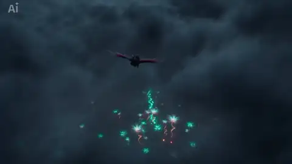

# Phoenix Ride Over the Night Jungle — by @draavenai

[← Back to Community Examples](../../EXAMPLES.md) · Category: Video · Model: `Seedance 2.0`

<a href="https://x.com/draavenai/status/2124487194203304080"></a>

**[▶ Watch the full video on X](https://x.com/draavenai/status/2124487194203304080)** — the preview above is a short silent clip.

Source: **[@draavenai on X](https://x.com/draavenai/status/2124487194203304080)** · Creator: [Draaven](https://x.com/draavenai)

## Prompt

```text
A breathtaking cinematic fantasy adventure featuring a young male warrior riding a magnificent giant magical phoenix bird through a mysterious tropical jungle at night. The bird has enormous colorful wings with glowing turquoise, purple, and pink feathers, bright magical eyes, and a long elegant tail. The rider wears a dark fantasy outfit and holds tightly onto the bird as it flies above a glowing river surrounded by lush palm trees. Colorful magical fireworks explode across the night sky, illuminating the clouds and jungle. The phoenix performs spectacular aerial turns, spreading its giant wings as sparkling magical particles trail behind it. A beautiful full moon shines above the jungle. Smooth aerial camera tracking, breathtaking wide shots, realistic feather details, vibrant fantasy colors, cinematic lighting, ultra-detailed 3D CGI, 4K movie quality.
```

## Try it

Paste the prompt into **[vinano.ai](https://vinano.ai?utm_source=github&utm_medium=readme&utm_campaign=awesome-image-video-prompts-updating&utm_content=x-page-try)** to generate your own version.

> The video and prompt belong to @draavenai ([original post](https://x.com/draavenai/status/2124487194203304080)) and are shown here with credit for reference. Creators can ask for changes or removal by opening an issue.
