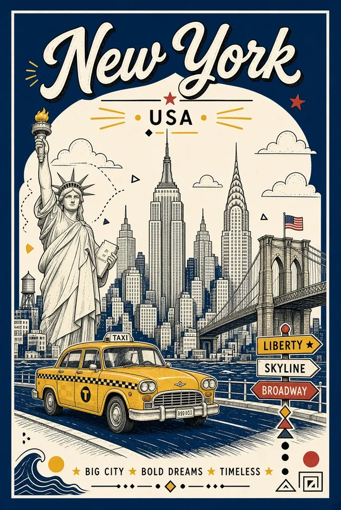

# Hand-Drawn City Travel Print Template — by @Aiwithkami

[← Back to Community Examples](../../EXAMPLES.md) · Category: Poster Design · Model: `GPT Image 2.6`

<a href="https://x.com/Aiwithkami/status/2124401464932184540"></a>

Source: **[@Aiwithkami on X](https://x.com/Aiwithkami/status/2124401464932184540)** · Creator: [Kami AI](https://x.com/Aiwithkami)

## Prompt

```text
INTERNATIONAL CITY TRAVEL ART PRINT COLLECTION

Create a charming, vintage-inspired travel poster featuring [CITY / COUNTRY], illustrated in a distinctive hand-drawn architectural doodle style.

Showcase the city's most iconic landmarks, buildings, monuments, towers, bridges, and recognizable architectural details, arranged together in a dense yet balanced artistic composition. Incorporate a recognizable local element, such as a vintage car, tram, taxi, bicycle, or public transport, in the foreground.

Use bold black ink outlines, intricate hand-drawn details, playful geometric patterns, and slightly imperfect sketch-like textures. Add the city name prominently within the illustration using creative hand-lettered typography.

Present the artwork inside a clean white poster border, surrounded by a vibrant solid-color background that complements the city's identity. Use a limited palette of black, warm white, and one or two bold accent colors.

Overall aesthetic: Minimalist European travel illustration, retro souvenir poster, whimsical architectural line art, screen-print texture, playful composition, and premium collectible wall-art design.

Keep the artwork visually cohesive, highly detailed, charming, and instantly recognizable as a celebration of the destination. Avoid photorealism, 3D effects, gradients, and unnecessary decorative elements.
```

## Try it

Paste the prompt into **[vinano.ai](https://vinano.ai?utm_source=github&utm_medium=readme&utm_campaign=awesome-image-video-prompts-updating&utm_content=x-page-try)** to generate your own version.

> The image and prompt belong to @Aiwithkami ([original post](https://x.com/Aiwithkami/status/2124401464932184540)) and are shown here with credit for reference. Creators can ask for changes or removal by opening an issue.
