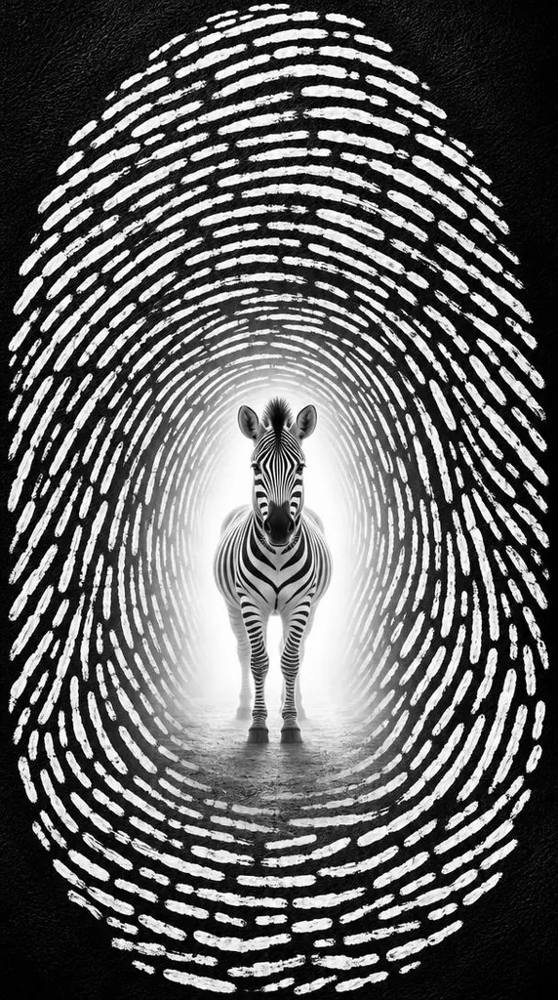

# Zebra in the Fingerprint Tunnel — by @churvikv

[← Back to Community Examples](../../EXAMPLES.md) · Category: Poster Design · Model: `GPT Image 2.6 Sunburst`

<a href="https://x.com/churvikv/status/2123819465796206817"></a>

Source: **[@churvikv on X](https://x.com/churvikv/status/2123819465796206817)** · Creator: [Viki](https://x.com/churvikv)

## Prompt

```text
High-contrast black-and-white conceptual artwork, tall 9:16 vertical composition, mixed-media graphic style. Full bleed edge to edge, no frame, no border, no lettering.
BACKGROUND: a rich matte black surface with a fine pebbled leather grain and subtle diagonal texture, deepening to pure black at the corners and edges.
FINGERPRINT: one enormous white fingerprint fills the frame as the dominant graphic element, its outline a wide oval, slightly tapering toward the top. It is drawn not as solid lines but as hundreds of broken dashed strokes and short parallel bars with softly rounded ends, hand-painted with slight thickness variation, some strokes irregular and chipped. The ridges sweep in long concentric arches and whorls, curving up over the crown and down both sides, with a dense tight cluster of concentric rings in the centre.
TUNNEL: dead centre, the fingerprint ridges part to form a glowing opening — a soft luminous white corridor receding into the distance, its walls a smooth radiant gradient of blurred white and pale grey, brightest at the far end, dissolving into a bright misty haze that halos the centre of the print.
ZEBRA: inside that opening walks a single zebra, seen from directly behind, moving away from the viewer toward the light. Its body is compact and symmetrical, coat a crisp pattern of black and white vertical stripes, a dark mane standing up in a short brush between two rounded ears, a long thin tail hanging straight down the middle of its back, hindquarters rounded and hind hooves faintly visible in the haze. Its silhouette is sharp and dark against the glowing tunnel, its stripes echoing the ridges of the fingerprint around it.
LIGHT: soft white backlight pouring out from the tunnel mouth onto the zebra, rim-lighting its ears and flanks, a gentle glow bleeding into the surrounding ridges.
PALETTE: pure black, charcoal, soft white, pearl grey. Graphic poster feel, minimalist, surreal.
```

## Try it

Paste the prompt into **[vinano.ai](https://vinano.ai?utm_source=github&utm_medium=readme&utm_campaign=awesome-image-video-prompts-updating&utm_content=x-page-try)** to generate your own version.

> The image and prompt belong to @churvikv ([original post](https://x.com/churvikv/status/2123819465796206817)) and are shown here with credit for reference. Creators can ask for changes or removal by opening an issue.
