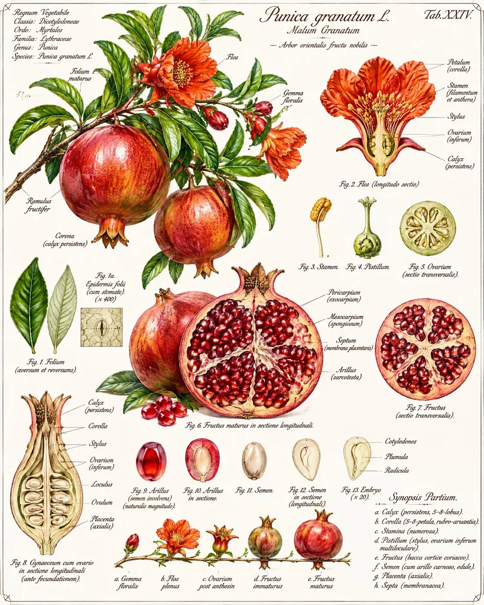

# Dragon Fruit Botanical Plate — by @sipteaandcoffee

[← Back to Community Examples](../../EXAMPLES.md) · Category: Illustration & 3D · Model: `GPT Image 2.6`

<a href="https://x.com/sipteaandcoffee/status/2123882892279349442"></a>

Source: **[@sipteaandcoffee on X](https://x.com/sipteaandcoffee/status/2123882892279349442)** · Creator: [kold Coffee](https://x.com/sipteaandcoffee)

## Prompt

```text
A highly detailed scientific botanical study of dragon fruit (Selenicereus undatus), illustrated in the style of 19th-century natural history journals. Delicate antique ink linework, exquisite hand-painted watercolor, natural pigments, vivid magenta-pink dragon fruits with curved green bracts, whole mature fruits attached to climbing cactus stems, sliced dragon fruit revealing luminous white flesh densely scattered with tiny black seeds, detailed anatomical cross-sections, magnified seed morphology, spectacular large white night-blooming cactus flowers with golden stamens, green three-ribbed cactus stems and small spines, fine botanical leader lines, elegant handwritten Latin specimen labels in sepia ink, refined scientific plate arrangement, antique scholarly aesthetic, pristine white background, hyper-detailed museum-quality natural history illustration, 4:5 aspect ratio.
```

## Try it

Paste the prompt into **[vinano.ai](https://vinano.ai?utm_source=github&utm_medium=readme&utm_campaign=awesome-image-video-prompts-updating&utm_content=x-page-try)** to generate your own version.

> The image and prompt belong to @sipteaandcoffee ([original post](https://x.com/sipteaandcoffee/status/2123882892279349442)) and are shown here with credit for reference. Creators can ask for changes or removal by opening an issue.
