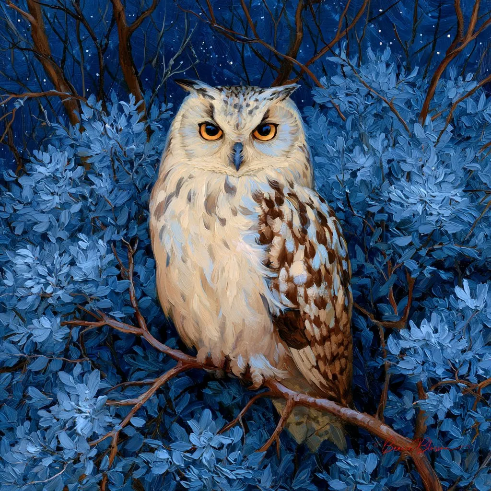

# Impressionist Night Owl — by @BeanieBlossom

[← Back to Community Examples](../../EXAMPLES.md) · Category: Illustration & 3D · Model: ``

<a href="https://x.com/BeanieBlossom/status/2124427686403854735"></a>

Source: **[@BeanieBlossom on X](https://x.com/BeanieBlossom/status/2124427686403854735)** · Creator: [Beanie Blossom](https://x.com/BeanieBlossom)

## Prompt

```text
an impressionistic painting featuring a central owl perched on a branch at night. the owl has soft light cream chest feathers, brown patterned wings, and striking yellow orange eyes. it rests on a brown twig amidst a dense background of blue bushes and branches. rich texture is created using thick paint application, giving a luminous, starry night atmosphere to the dark blue backdrop.
```

## Try it

Paste the prompt into **[vinano.ai](https://vinano.ai?utm_source=github&utm_medium=readme&utm_campaign=awesome-image-video-prompts-updating&utm_content=x-page-try)** to generate your own version.

> The image and prompt belong to @BeanieBlossom ([original post](https://x.com/BeanieBlossom/status/2124427686403854735)) and are shown here with credit for reference. Creators can ask for changes or removal by opening an issue.
