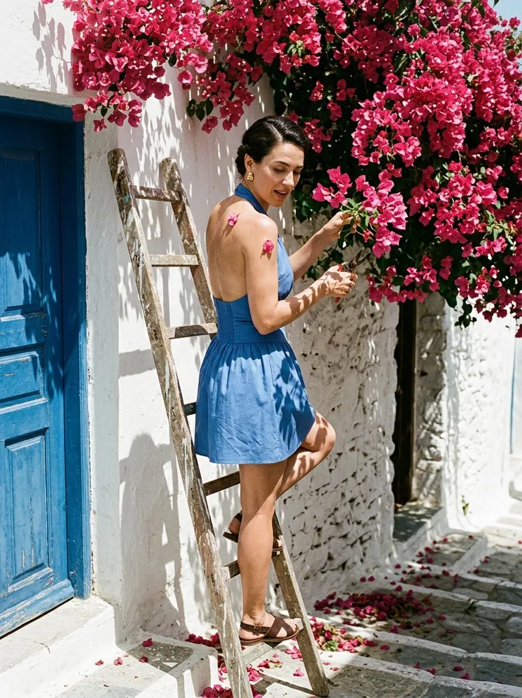

# Bougainvillea Ladder Editorial — by @dreamydigiarts

[← Back to Community Examples](../../EXAMPLES.md) · Category: Photography · Model: `Nano Banana 2`

<a href="https://x.com/dreamydigiarts/status/2123997330747850918"></a>

Source: **[@dreamydigiarts on X](https://x.com/dreamydigiarts/status/2123997330747850918)** · Creator: [dreamy digital arts](https://x.com/dreamydigiarts)

## Prompt

```text
fashion editorial in a narrow Greek island alley at harsh midday, with chalk-white stone walls, a weathered cobalt door, and an enormous fuchsia bougainvillea spilling overhead.

An adult woman stands midway up a paint-marked wooden ladder, framed from just below the knee upward so she remains dominant while the flowers press tightly around the top and sides of the image.

She wears an blue poplin halter dress with a close sculpted waist, broad open back, and a short softly structured skirt, paired with dark brown leather sandals and small hammered-gold earrings. Style her hair in a compact low twist with an irregular side part, leaving the neck and shoulders clear.

One hand steadies the ladder while the other holds a small pair of garden shears beside a freshly cut bougainvillea branch. Loose petals cling to one shoulder and scatter across the stone below. She turns down toward the camera with a slightly breathless, amused expression, as if interrupted halfway through the task.

Photograph from close below ladder height, slightly off-axis, with the cobalt doorway cutting into one edge of the frame and dense flowers filling the opposite side.

Hard Mediterranean sun creates sharp leaf-and-flower shadows across the white wall, her bare shoulders, and the dress. Preserve sun-faded paint, limewashed stone, dry petals, cotton structure, worn ladder wood, natural skin, and restrained film grain.
```

## Try it

Paste the prompt into **[vinano.ai](https://vinano.ai?utm_source=github&utm_medium=readme&utm_campaign=awesome-image-video-prompts-updating&utm_content=x-page-try)** to generate your own version.

> The image and prompt belong to @dreamydigiarts ([original post](https://x.com/dreamydigiarts/status/2123997330747850918)) and are shown here with credit for reference. Creators can ask for changes or removal by opening an issue.
