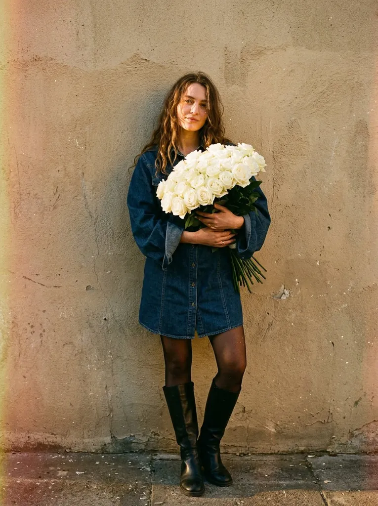

# White Roses Golden-Hour Film Portrait — by @dreamydigiarts

[← Back to Community Examples](../../EXAMPLES.md) · Category: Photography · Model: `Nano Banana 2`

<a href="https://x.com/dreamydigiarts/status/2124337084575932832"></a>

Source: **[@dreamydigiarts on X](https://x.com/dreamydigiarts/status/2124337084575932832)** · Creator: [dreamy digital arts](https://x.com/dreamydigiarts)

## Prompt

```text
A raw-style photo with a vintage film effect and added grain. The woman stands relaxed, leaning her back against a wall during golden hour. In both hands, she holds a bouquet of huge white roses, more than 30 flowers. She presses it against her chest. Her long, wavy hair falls slightly over her face, creating a natural, unposed look. Part of her face is illuminated by sunbeams, giving the image the warm and soft lighting characteristic of golden hour. The woman looks at the camera. She is wearing a short dark denim shirt dress with long, wide sleeves; the buttons on the chest are fastened all the way to the hem of the dress; black nylon tights and high black boots. The background is minimalist, helping focus attention on her appearance and the atmosphere. Y2K style. Format 9:16.
```

## Try it

Paste the prompt into **[vinano.ai](https://vinano.ai?utm_source=github&utm_medium=readme&utm_campaign=awesome-image-video-prompts-updating&utm_content=x-page-try)** to generate your own version.

> The image and prompt belong to @dreamydigiarts ([original post](https://x.com/dreamydigiarts/status/2124337084575932832)) and are shown here with credit for reference. Creators can ask for changes or removal by opening an issue.
