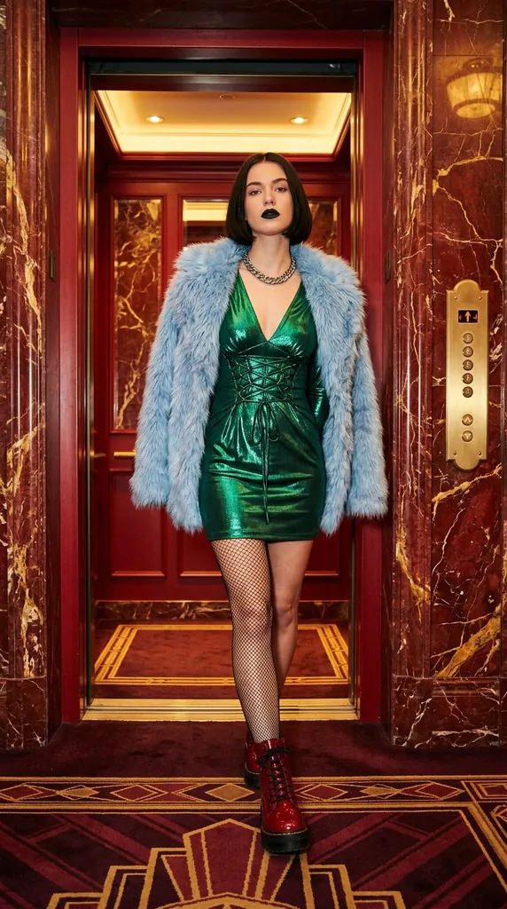

# Red Marble Elevator Fashion Shot — by @dreamydigiarts

[← Back to Community Examples](../../EXAMPLES.md) · Category: Photography · Model: `Nano Banana 2`

<a href="https://x.com/dreamydigiarts/status/2124359718840021220"></a>

Source: **[@dreamydigiarts on X](https://x.com/dreamydigiarts/status/2124359718840021220)** · Creator: [dreamy digital arts](https://x.com/dreamydigiarts)

## Prompt

```text
A fashion-forward woman stands confidently in front of a red elevator with marble walls.  Subject: A woman with short dark hair and bold black lipstick, wearing a metallic green mini dress with a deep V-neckline and lace-up front detail.  Clothing: She wears a fluffy light blue faux fur coat draped over her shoulders, purple fishnet stockings on one leg, and red platform boots. A chunky silver necklace adorns her neck.  Action: She stands with hands behind her back, looking directly at the camera with a serious expression.  Environment: The setting is an elegant elevator lobby with red marble walls, a red carpet with geometric patterns, and an elevator panel visible to the side.  Camera: Medium full-body shot centered on the subject, framed symmetrically within the elevator doorway.  Lighting: Warm ambient lighting highlights the metallic sheen of the dress and soft texture of the fur coat, casting gentle shadows behind the subject.  Style Details: High-fashion editorial aesthetic with rich color contrast between green, blue, red, and gold tones; polished studio photography quality.
```

## Try it

Paste the prompt into **[vinano.ai](https://vinano.ai?utm_source=github&utm_medium=readme&utm_campaign=awesome-image-video-prompts-updating&utm_content=x-page-try)** to generate your own version.

> The image and prompt belong to @dreamydigiarts ([original post](https://x.com/dreamydigiarts/status/2124359718840021220)) and are shown here with credit for reference. Creators can ask for changes or removal by opening an issue.
