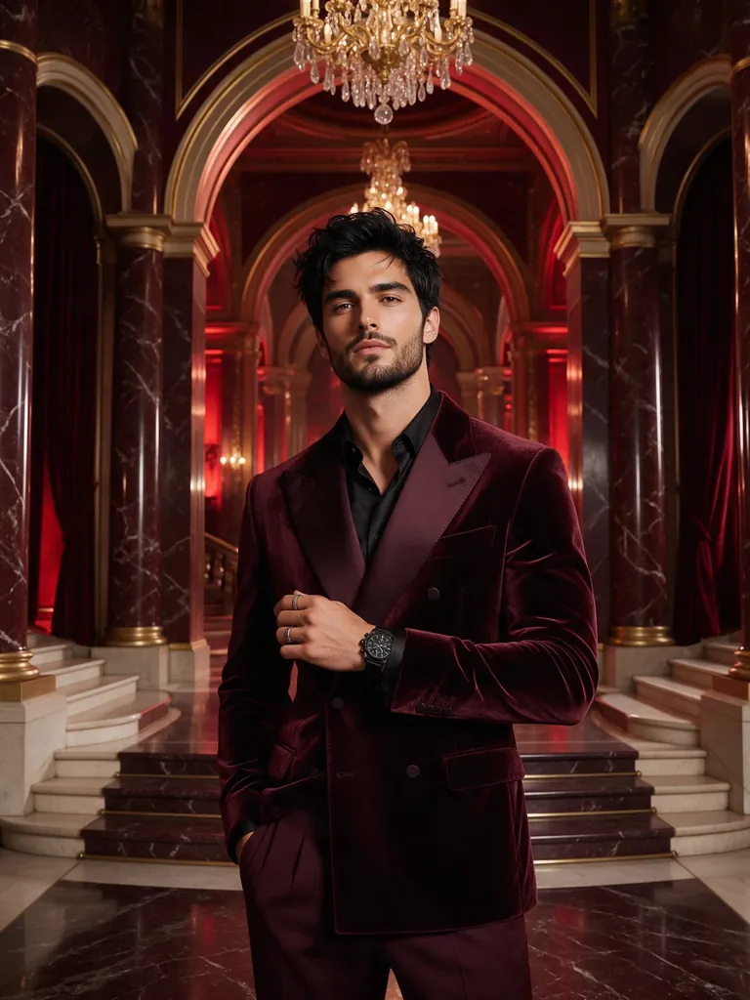

# Oxblood Velvet Suit Campaign — by @AaqibVx

[← Back to Community Examples](../../EXAMPLES.md) · Category: Photography · Model: `Seedream 5.0 Pro`

<a href="https://x.com/AaqibVx/status/2124491385902657815"></a>

Source: **[@AaqibVx on X](https://x.com/AaqibVx/status/2124491385902657815)** · Creator: [Aaqib ali](https://x.com/AaqibVx)

## Prompt

```text
Create a breathtaking, ultra-photorealistic, billion-dollar luxury fashion campaign featuring an exceptionally handsome young man with thick, naturally textured black hair, a perfectly sculpted beard, captivating eyes and an effortlessly powerful masculine presence.

**THE SIGNATURE LOOK:** A breathtaking custom-designed deep oxblood wine-red velvet double-breasted suit, perfectly tailored with sharp architectural shoulders, paired with a luxurious black silk shirt, subtly unbuttoned collar, an elegant black luxury watch and sophisticated silver rings. Every element must communicate exclusivity, confidence and elite fashion.

**THE ICONIC POSE:** The man stands at the centre of a magnificent grand architectural staircase, one hand casually resting inside his trouser pocket, the other adjusting his suit cuff. His shoulders are naturally positioned, chin slightly raised, looking directly into the camera with an intense, composed expression. His presence should feel commanding, effortless and unforgettable.

**THE ENVIRONMENT:** A spectacular modern royal palace interior featuring enormous burgundy marble columns, magnificent golden chandeliers, deep wine-red velvet architectural details and polished reflective marble flooring. Behind him, an enormous sculptural arch creates a dramatic cinematic frame around his silhouette.

**CINEMATIC LIGHTING:** Rich crimson illumination from the architectural background, warm champagne-gold highlights from the chandeliers, beautifully controlled shadows across his face and a delicate red rim light defining his silhouette. Realistic skin tones must remain natural.

**CAMERA DIRECTION:** Captured from a slightly low camera angle using an 85mm professional portrait lens, cinematic three-quarter body composition, extraordinary depth, razor-sharp facial focus and perfectly balanced architectural symmetry.

**COLOUR MASTERPIECE:** Deep oxblood, royal burgundy, sophisticated black and restrained champagne gold. Absolutely no neon green, no excessive saturation.

**FINAL AESTHETIC:** International luxury fashion-house campaign, royal sophistication meets modern celebrity attitude, world-class editorial photography, extraordinary realism, lifelike skin texture, realistic hands, intricate velvet details, 8K ultra-high definition.

The image must feel like an exclusive campaign photographed for one of the world's most prestigious luxury fashion houses. Visually unforgettable, sophisticated, powerful and genuinely photographic.

NO TEXT. NO LOGOS. NO WATERMARKS. NO CARTOON EFFECTS. NO PLASTIC SKIN. NO CHEAP AI AESTHETICS.
```

## Try it

Paste the prompt into **[vinano.ai](https://vinano.ai?utm_source=github&utm_medium=readme&utm_campaign=awesome-image-video-prompts-updating&utm_content=x-page-try)** to generate your own version.

> The image and prompt belong to @AaqibVx ([original post](https://x.com/AaqibVx/status/2124491385902657815)) and are shown here with credit for reference. Creators can ask for changes or removal by opening an issue.
