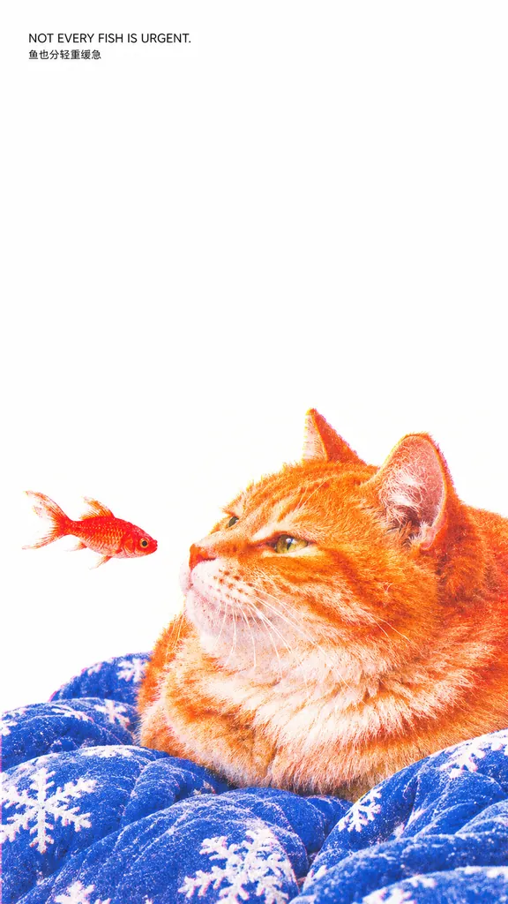

# Deadpan Cat and Fish Photocopy Art — by @hx831126

[← Back to Community Examples](../../EXAMPLES.md) · Category: Illustration & 3D · Model: ``

<a href="https://x.com/hx831126/status/2124477388608164286"></a>

Source: **[@hx831126 on X](https://x.com/hx831126/status/2124477388608164286)** · Creator: [虎小象](https://x.com/hx831126)

## Prompt

```text
Create ONE original vertical 9:16 artwork, from scratch. A high-chroma color photocopy collage with large uninterrupted near-white paper, saturated selectively overprinted pigments, mottled grain and tonal breakup only in the ink, tiny patches of missing ink, light registration drift, and realistic animal eyes/texture grounded in a funny deadpan gesture. Two or three saturated colors; no 3D, no sleek vector, no flat cartoon, no beige tint. Treat the picture and paper as one continuous composition with no header/footer separated from the artwork. Set exactly two small typographic annotations within the specified naturally empty white area: a quiet very small sans-serif English line (roughly 20–31% canvas width, not title size), with an even smaller clear Simplified Chinese line 0.65 as large directly below aligned on the same margin. Tiny but clean correct letters, black ink, about 7% margin from edges. Do not add any other type, page mark, index, page number, bar, rule, logo, watermarks, boxes or layout panels. The joke should read first in the image, and the small line then invites a second thought. All artwork, including text, made in this single generation.

01 揣手猫与鱼
Art: Slightly elevated side view: a winter-furred orange cat sits low and right on the bunched cobalt-blue corner of a winter quilt with its two front paws tucked deep under its chest, both paws completely hidden; it looks calmly sideways at one small, bright vermilion fish, swimming in the white paper air near its nose. Only one fish, no tank. Dramatic white space above.
Annotation position: upper-left white, both lines left aligned.
Exact English annotation (omit quotes): "NOT EVERY FISH IS URGENT."
Exact tiny Chinese annotation (omit quotes): "鱼也分轻重缓急"
```

## Try it

Paste the prompt into **[vinano.ai](https://vinano.ai?utm_source=github&utm_medium=readme&utm_campaign=awesome-image-video-prompts-updating&utm_content=x-page-try)** to generate your own version.

> The image and prompt belong to @hx831126 ([original post](https://x.com/hx831126/status/2124477388608164286)) and are shown here with credit for reference. Creators can ask for changes or removal by opening an issue.
