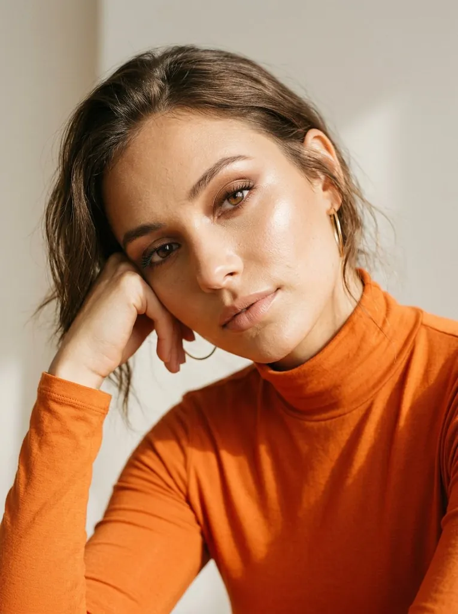

# Sunlit Orange Beauty Portrait — by @dreamydigiarts

[← Back to Community Examples](../../EXAMPLES.md) · Category: Photography · Model: `Nano Banana 2`

<a href="https://x.com/dreamydigiarts/status/2124133231779832177"></a>

Source: **[@dreamydigiarts on X](https://x.com/dreamydigiarts/status/2124133231779832177)** · Creator: [dreamy digital arts](https://x.com/dreamydigiarts)

## Prompt

```text
Beauty fashion portrait in aesthetic sunlit glow / modern minimal glam / warm editorial. Warm, sensual, confident woman with natural appeal. Close-up (crop to chest). Accent on eyes, cheekbones, and skin texture. Neutral light background. Minimalism without unnecessary details. Model leans her head on her hand, creating a soft diagonal in the frame. Head slightly tilted to the side. One hand supports the head. Eyes looking directly at the camera - deep, calm, magnetic. Lips relaxed, naturally closed. Soft but confident pose. Hair loose, light natural texture. Part of the hair tucked behind the ear, part falling freely along the face. Soft side or slightly offset parting. Natural styling. Tight-fitting long-sleeve in a bright orange shade. Smooth fabric. Minimalist gold hoop earrings. Modern minimalism with a bright color accent. Glow editorial makeup: warm blending on eyes, emphasized lashes, light face sculpting, pronounced highlighter on cheekbones, nude lips with a soft satin finish. Warm directional light. Soft shadows. Light emphasizes skin glow, cheekbone volume, and fabric texture. Moderate contrast, sunny, editorial-level. Clean warm color correction. Accent on skin glow, orange saturation, and natural texture. Without aggressive retouching. Premium beauty campaign finish.
```

## Try it

Paste the prompt into **[vinano.ai](https://vinano.ai?utm_source=github&utm_medium=readme&utm_campaign=awesome-image-video-prompts-updating&utm_content=x-page-try)** to generate your own version.

> The image and prompt belong to @dreamydigiarts ([original post](https://x.com/dreamydigiarts/status/2124133231779832177)) and are shown here with credit for reference. Creators can ask for changes or removal by opening an issue.
