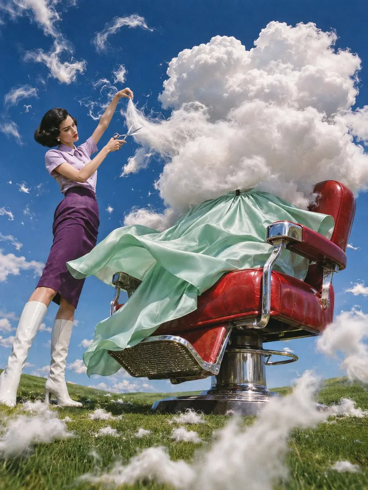

# Cloud Barber Surreal Editorial — by @DeepBlueX0

[← Back to Community Examples](../../EXAMPLES.md) · Category: Photography · Model: `GPT Image 2.6`

<a href="https://x.com/DeepBlueX0/status/2124351549480866153"></a>

Source: **[@DeepBlueX0 on X](https://x.com/DeepBlueX0/status/2124351549480866153)** · Creator: [DeepBlue深藍](https://x.com/DeepBlueX0)

## Prompt

```text
Cloud Barber｜超現實高訂攝影 × 巨物尺度 × 複雜物理交互

A spectacular, playful yet sophisticated surreal high-fashion editorial photograph, blending 1960s retro fashion photography, monumental-scale surrealism, cinematic wide-angle perspective, and intricate physical interactions.

On a vividly saturated emerald-green hill beneath an immense cobalt-blue sky, an oversized cherry-red vintage barber chair stands like a surreal sculptural monument. Seated inside is an enormous, exquisitely detailed living cumulus cloud, billowing far above the chair, wearing a flowing mint-green satin barber cape.

Beside the chair stands an elegant adult female fashion model with a perfectly sculpted glossy black retro bob, wearing a fitted pale-lavender short-sleeved blouse, a deep-purple pencil skirt, and immaculate white knee-high leather boots.

Capture the exact split second of an impossible haircut.

With one hand, the model delicately lifts a long, semi-transparent strand of cloud between her fingers. With the other, she closes a pair of polished silver scissors precisely through the floating strand. Her fingers, scissors, and the delicate cloud fibers form a visually convincing point of contact.

The freshly severed cloud fragment curls and separates, breaking into hundreds of delicate wisps of varying sizes. Some drift through the sunlight, some spiral gently around the chair, while others settle onto the vivid grass like freshly cut hair.

A consistent breeze subtly lifts the edges of the mint satin cape, bends the surrounding grass, and carries the cloud fragments in a coherent direction. The model’s posture responds naturally to the action, her focused expression contrasting with the absurdity of the scene.

The giant cloud exhibits extraordinary volumetric complexity: luminous semi-translucent edges, intricate wispy filaments, dense cotton-like interiors, soft internal shadow gradients, delicate light scattering, and realistic atmospheric depth. Its silhouette remains monumental, sculptural, and immediately recognizable.

The barber chair features rich lacquered red leather, polished chrome armrests, subtle wear, intricate mechanical components, and convincing reflections. The cape has elegant flowing folds, realistic fabric tension, and soft specular highlights.

Composition: A dramatic ground-level 24mm wide-angle fashion photograph. The enormous cloud dominates the upper-middle composition, the model creates an elegant diagonal gesture toward the cutting point, and the red chair anchors the scene. A few large cloud fragments float close to the lens, creating layered foreground, middle-ground, and background depth.

The blue sky occupies a generous portion of the frame, preserving a striking minimalist graphic silhouette. The landscape remains clean and uncluttered.

Lighting: Brilliant late-morning sunlight, subtle direct-flash fill, realistic contact shadows, luminous cloud edges, finely controlled highlights, and coherent reflections across every surface.

Visual aesthetic: Premium analog fashion editorial, vivid yet sophisticated color separation, subtle Kodak Ektar-style film grain, tactile photographic realism, precise surreal art direction, playful visual irony, and exceptional material detail.

The final image should feel like an extraordinary real-world fashion photograph documenting an impossible event, with sophisticated visual storytelling and astonishing physical coherence.

3:4 vertical composition. No text, no logos, no borders.
```

## Try it

Paste the prompt into **[vinano.ai](https://vinano.ai?utm_source=github&utm_medium=readme&utm_campaign=awesome-image-video-prompts-updating&utm_content=x-page-try)** to generate your own version.

> The image and prompt belong to @DeepBlueX0 ([original post](https://x.com/DeepBlueX0/status/2124351549480866153)) and are shown here with credit for reference. Creators can ask for changes or removal by opening an issue.
