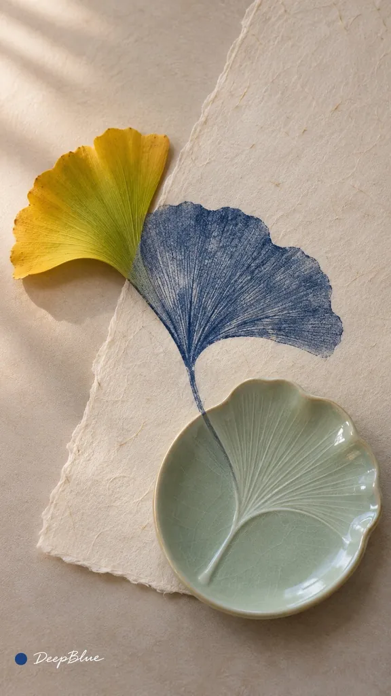

# One Object, Three Realms — by @DeepBlueX0

[← Back to Community Examples](../../EXAMPLES.md) · Category: Photography · Model: `GPT Image 2.6`

<a href="https://x.com/DeepBlueX0/status/2124676146642276799"></a>

Source: **[@DeepBlueX0 on X](https://x.com/DeepBlueX0/status/2124676146642276799)** · Creator: [DeepBlue深藍](https://x.com/DeepBlueX0)

## Prompt

```text
《一物三藏》｜自然標本 × 跨媒介三相轉譯 × 東方實驗藝術攝影。

每張獨立選擇一種具有鮮明形態與紋理的自然原物，從植物、花果、菌類、貝殼、羽毛、礦石、化石或其他自然標本中自由抽取。

圍繞這件自然原物，自由選擇一種藝術工藝與一件人工器物，利用原物的形態、紋理、色彩或結構，創造出人意料的跨媒介關聯。

可以探索接觸顯影、影子補形、輪廓接續、材料轉化、平面與立體互換、光學錯覺、時間留痕，以及更多自行發明的視覺機關。讓自然原物的本相、跨媒介留下的留相，以及令人意外的幻相形成巧妙互動，觀眾第一眼看懂主角，第二眼發現令人驚喜的細節。

每張自由設計三相關係、材料、工藝、構圖、觀看方式與場景。鼓勵詩意、幽默、荒誕和意外發現，讓創意自然融入可信的實體世界。

融合東方極簡美學與當代實驗藝術攝影。真實 iPhone 原相機質感，自然光、準確曝光、乾淨暗部、低噪點、低 HDR、柔和真實的材料紋理。構圖疏朗，主次分明，適當留白，保持清爽通透的視覺質感。

9:16 直式獨立單圖，每張分別生成。左下深藍色實心圓點，後接白色極細字體「DeepBlue」。

n=9
```

## Try it

Paste the prompt into **[vinano.ai](https://vinano.ai?utm_source=github&utm_medium=readme&utm_campaign=awesome-image-video-prompts-updating&utm_content=x-page-try)** to generate your own version.

> The image and prompt belong to @DeepBlueX0 ([original post](https://x.com/DeepBlueX0/status/2124676146642276799)) and are shown here with credit for reference. Creators can ask for changes or removal by opening an issue.
