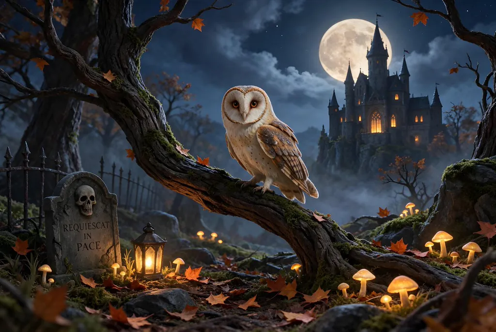

# Barn Owl and Moonlit Castle — by @heathergreen

[← Back to Community Examples](../../EXAMPLES.md) · Category: Illustration & 3D · Model: `Seedream 5.5`

<a href="https://x.com/heathergreen/status/2124488074713260248"></a>

Source: **[@heathergreen on X](https://x.com/heathergreen/status/2124488074713260248)** · Creator: [Heather Green](https://x.com/heathergreen)

## Prompt

```text
A detailed, high-fantasy digital stop-motion style illustration featuring a majestic barn owl with bright amber eyes perched on a mossy, gnarled tree branch in the foreground. The owl is the central focus, surrounded by a dark, atmospheric forest setting during autumn. The forest floor is dotted with glowing, bioluminescent mushrooms and scattered orange maple leaves. In the background, a mysterious, gothic-style castle looms under a large, luminous full moon in a misty, dark blue sky. To the left, a weathered tombstone with a skull carving stands near a wrought-iron fence and a glowing lantern, enhancing the eerie, magical, and autumnal mood of the scene. The lighting is moody and cinematic, with soft glows emanating from the mushrooms and the distant castle windows.
```

## Try it

Paste the prompt into **[vinano.ai](https://vinano.ai?utm_source=github&utm_medium=readme&utm_campaign=awesome-image-video-prompts-updating&utm_content=x-page-try)** to generate your own version.

> The image and prompt belong to @heathergreen ([original post](https://x.com/heathergreen/status/2124488074713260248)) and are shown here with credit for reference. Creators can ask for changes or removal by opening an issue.
