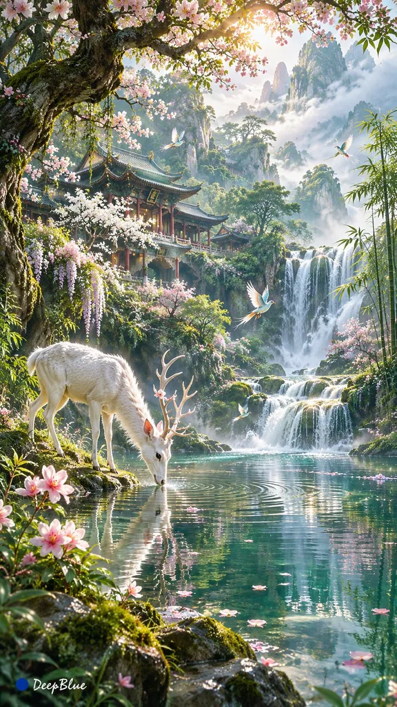

# Eastern Fairyland Spirit Creatures — by @DeepBlueX0

[← Back to Community Examples](../../EXAMPLES.md) · Category: Illustration & 3D · Model: `GPT Image 2.6`

<a href="https://x.com/DeepBlueX0/status/2124381286584422423"></a>

Source: **[@DeepBlueX0 on X](https://x.com/DeepBlueX0/status/2124381286584422423)** · Creator: [DeepBlue深藍](https://x.com/DeepBlueX0)

## Prompt

```text
《萬物有靈》｜極致東方仙境美學 × 古典山水造境 × 靈物共生 × 電影級幻想攝影。

每張獨立創造一處宏大、空靈、生機盎然的東方山水仙境。

自由選擇具有東方古典氣韻的宮殿、寺觀、樓閣、水榭或其他古建築，將其融入高山、峽谷、湖泊、雲海與繁茂自然之中。建築與山石、古樹、水流自然共生，形成壯麗而富有詩意的天地景觀。

【萬物有靈】

每張自由選擇具有東方文化意象的靈性生物，例如仙鶴、白鹿、靈鳥、錦鯉、蝴蝶，以及麒麟、青鸞等神話靈獸。

讓牠們以自然、生動且富有詩意的方式出現在山林、古建築與雲水之間。自由設計飛翔、回望、棲息、飲水、嬉戲、穿梭或彼此感應的瞬間，使生命活動與場景形成有趣的內在聯繫。

【草木生機】

古松、蘭草、竹林、藤蔓、荷花、山花、苔蘚及其他東方植物自然生長，依照不同氣候、地形與季節形成豐富而有節奏的生態景觀。

細風吹動枝葉，花瓣飄落，露珠閃爍，水面浮現漣漪，遠處飛鳥掠過雲層，整個仙境彷彿正在呼吸。

【仙境造境】

融合宋代山水畫的留白、三遠法、虛實相生與古典園林借景，形成宏大、空靈而具有深度的空間。

晨曦、柔和天光、山嵐、薄霧與水汽在建築、山林及靈物之間自然流動。微妙的逆光與空氣透視營造仙氣縹緲的氛圍，兼具真實自然的生命感與令人神往的超現實氣息。

每張自由探索不同的建築、靈物、植物、構圖、季節、光色與視覺敘事。讓畫面具有一個清晰的生命焦點，其他元素自然融入環境，形成豐富而和諧的整體。

極致東方美學，細膩真實的材質，自然光影，清雅色彩，靈動而有氣韻。具有電影級景觀攝影的真實感、古典山水的意境與仙境幻想的生命力。

9:16 竪幅構圖，每張分別生成。左下角低調放置深藍實心圓點#0B3D91 與白色自然手寫體「DeepBlue」署名。

n=6
```

## Try it

Paste the prompt into **[vinano.ai](https://vinano.ai?utm_source=github&utm_medium=readme&utm_campaign=awesome-image-video-prompts-updating&utm_content=x-page-try)** to generate your own version.

> The image and prompt belong to @DeepBlueX0 ([original post](https://x.com/DeepBlueX0/status/2124381286584422423)) and are shown here with credit for reference. Creators can ask for changes or removal by opening an issue.
