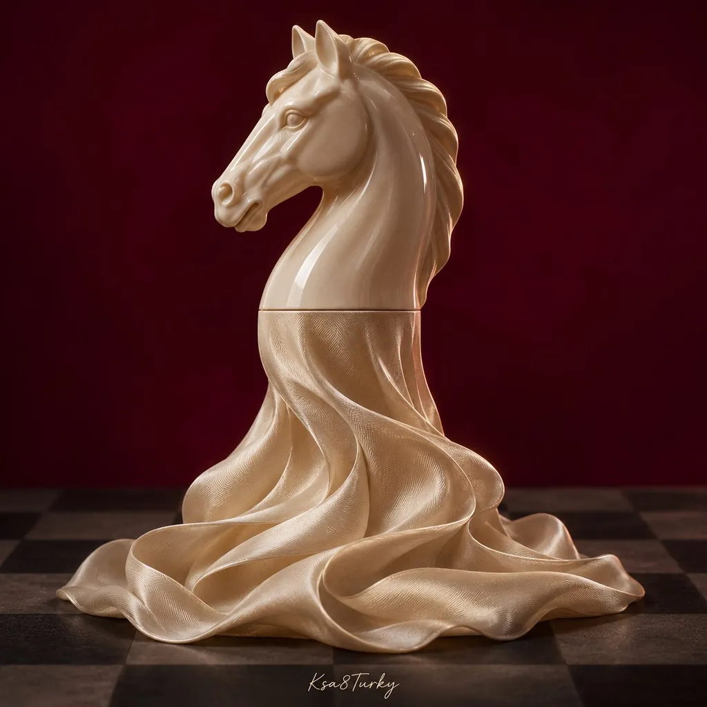

# Rigid-to-Soft Material Sculpture Template — by @ksa8Turky

[← Back to Community Examples](../../EXAMPLES.md) · Category: Photography · Model: `GPT Image`

<a href="https://x.com/ksa8Turky/status/2124272644769915045"></a>

Source: **[@ksa8Turky on X](https://x.com/ksa8Turky/status/2124272644769915045)** · Creator: [‏Turky](https://x.com/ksa8Turky)

## Prompt

```text
Create a square surreal fine-art studio photograph of ONE recognizable [OBJECT]. Its upper portion is made of [RIGID MATERIAL], transforming from one visible transition point into [SOFT MATERIAL] that flows down onto [SURFACE].

Example: an ivory ceramic chess knight whose lower neck becomes flowing ivory silk on a charcoal chessboard.

Preserve one continuous object and a readable material transition. Deep burgundy background, soft side light, controlled rim light, tactile surfaces and realistic contact shadows. No other chess pieces, people, brands or headline. Intentional impossible AI artwork. Small handwritten Ksa8Turky at bottom.
```

## Try it

Paste the prompt into **[vinano.ai](https://vinano.ai?utm_source=github&utm_medium=readme&utm_campaign=awesome-image-video-prompts-updating&utm_content=x-page-try)** to generate your own version.

> The image and prompt belong to @ksa8Turky ([original post](https://x.com/ksa8Turky/status/2124272644769915045)) and are shown here with credit for reference. Creators can ask for changes or removal by opening an issue.
