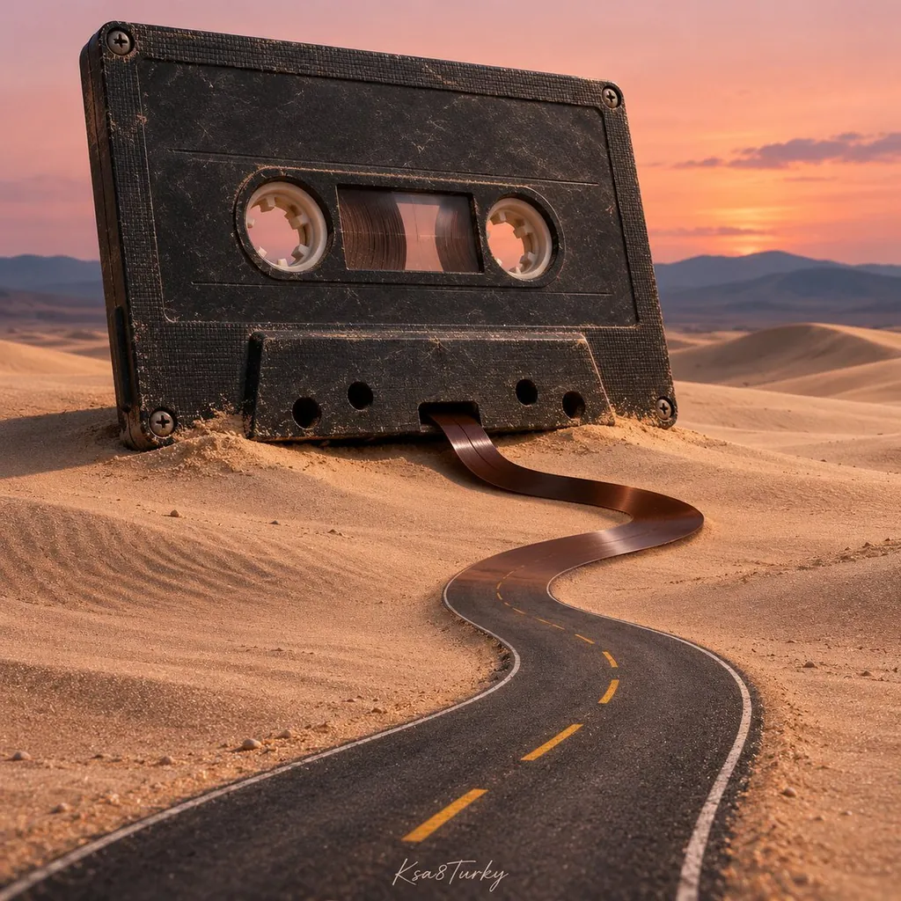

# Object Unspooling Into a Landscape — by @ksa8Turky

[← Back to Community Examples](../../EXAMPLES.md) · Category: Photography · Model: `GPT Image`

<a href="https://x.com/ksa8Turky/status/2124642834187784292"></a>

Source: **[@ksa8Turky on X](https://x.com/ksa8Turky/status/2124642834187784292)** · Creator: [‏Turky](https://x.com/ksa8Turky)

## Prompt

```text
Create a square surreal fine-art photograph of ONE unbranded [FAMILIAR OBJECT] in [ENVIRONMENT]. ONE continuous [EXTENDING COMPONENT] emerges from it and gradually becomes [NEW FORM], preserving a coherent uninterrupted path.

Example: a black vintage audio cassette on desert dunes, its glossy brown magnetic tape unspooling into a narrow asphalt road toward the foreground.

Keep the recognizable housing intact and the material transition visible. Tactile surfaces, peach twilight, cool distant hills, realistic contact shadows and clear thumbnail composition. One object, one path, no people or existing brands. Intentional AI artwork, not a functional-product claim. Small handwritten Ksa8Turky at bottom.
```

## Try it

Paste the prompt into **[vinano.ai](https://vinano.ai?utm_source=github&utm_medium=readme&utm_campaign=awesome-image-video-prompts-updating&utm_content=x-page-try)** to generate your own version.

> The image and prompt belong to @ksa8Turky ([original post](https://x.com/ksa8Turky/status/2124642834187784292)) and are shown here with credit for reference. Creators can ask for changes or removal by opening an issue.
