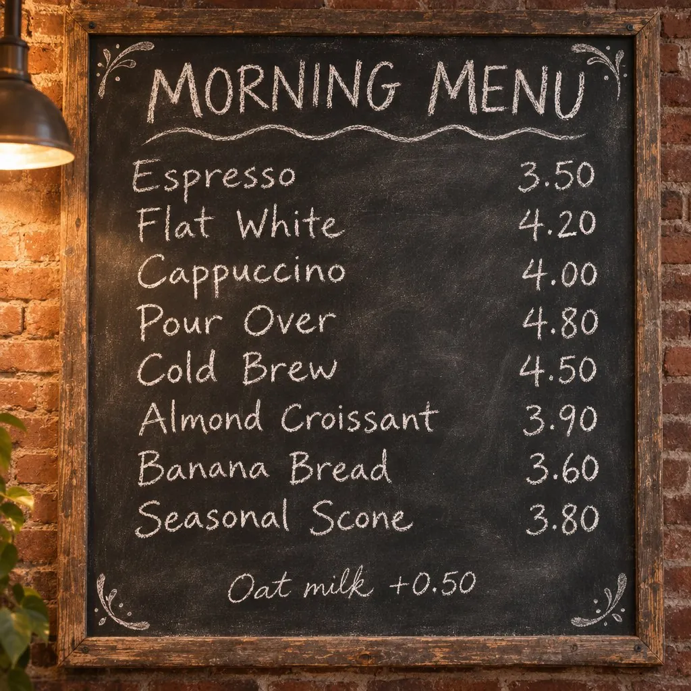

# Hand-Lettered Chalkboard Cafe Menu — by @DavidLi36143625

[← Back to Community Examples](../../EXAMPLES.md) · Category: UI & Graphic · Model: `GPT Image 2.6 Sunburst`

<a href="https://x.com/DavidLi36143625/status/2123941784585990611"></a>

Source: **[@DavidLi36143625 on X](https://x.com/DavidLi36143625/status/2123941784585990611)** · Creator: [David Liang](https://x.com/DavidLi36143625)

## Prompt

```text
A cafe menu written on a large dark chalkboard hanging on a brick wall. The chalkboard is framed in weathered wood. At the top, a hand-lettered title in white chalk: "MORNING MENU". Below the title, a hand-drawn wavy chalk line. Then a list of eight items, each on its own line, written in white chalk with slight natural unevenness in letter size and spacing, as if hand-lettered, with the item name left-aligned and the price right-aligned:
"Espresso - 3.50"
"Flat White - 4.20"
"Cappuccino - 4.00"
"Pour Over - 4.80"
"Cold Brew - 4.50"
"Almond Croissant - 3.90"
"Banana Bread - 3.60"
"Seasonal Scone - 3.80"
Below the list, a small line in a different handwriting style: "Oat milk +0.50". A few decorative chalk flourishes in the corners. All text appears exactly once, verbatim, no duplicate text, no invented items, no extra words. Chalk dust visible on the board surface, soft cafe lighting from the side, warm and slightly dim.
```

## Try it

Paste the prompt into **[vinano.ai](https://vinano.ai?utm_source=github&utm_medium=readme&utm_campaign=awesome-image-video-prompts-updating&utm_content=x-page-try)** to generate your own version.

> The image and prompt belong to @DavidLi36143625 ([original post](https://x.com/DavidLi36143625/status/2123941784585990611)) and are shown here with credit for reference. Creators can ask for changes or removal by opening an issue.
