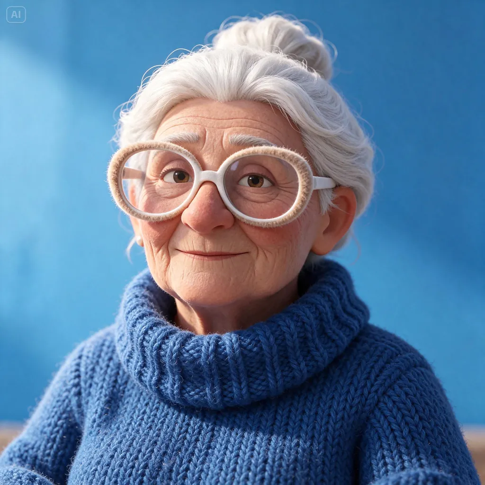

# Stylized 3D Grandma Portrait — by @mseymari_

[← Back to Community Examples](../../EXAMPLES.md) · Category: Illustration & 3D · Model: `Seedream 5.5`

<a href="https://x.com/mseymari_/status/2124054959041794332"></a>

Source: **[@mseymari_ on X](https://x.com/mseymari_/status/2124054959041794332)** · Creator: [mohammad seymari](https://x.com/mseymari_)

## Prompt

```text
Highly detailed stylized 3D portrait of an old woman with fluffy white hair, oversized fuzzy-framed glasses, expressive wrinkled face, pearl stud earring, chunky blue knit sweater, plain bright blue background, cinematic lighting, high quality
```

## Try it

Paste the prompt into **[vinano.ai](https://vinano.ai?utm_source=github&utm_medium=readme&utm_campaign=awesome-image-video-prompts-updating&utm_content=x-page-try)** to generate your own version.

> The image and prompt belong to @mseymari_ ([original post](https://x.com/mseymari_/status/2124054959041794332)) and are shown here with credit for reference. Creators can ask for changes or removal by opening an issue.
