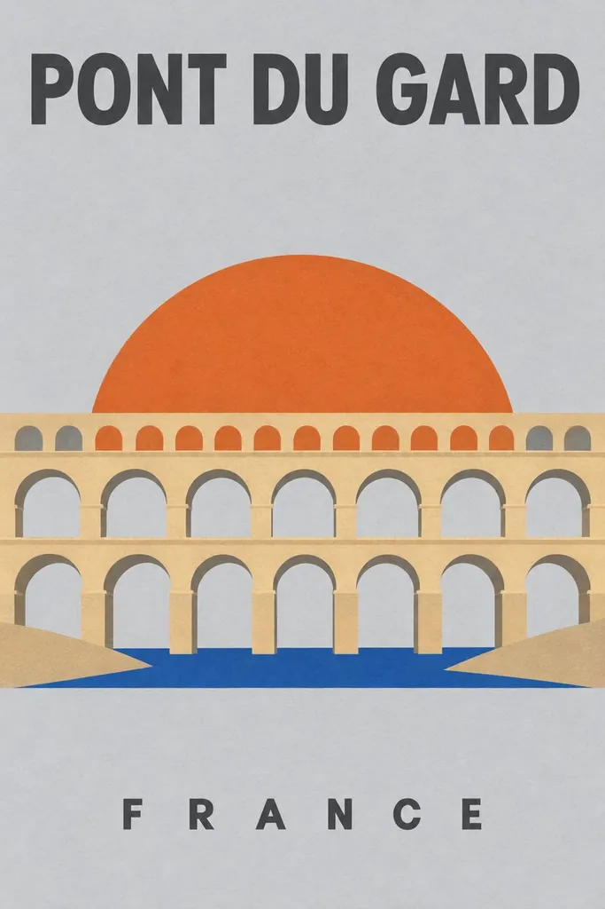

# Pont du Gard Minimalist Poster — by @Alyssa4aicreate

[← Back to Community Examples](../../EXAMPLES.md) · Category: Poster Design · Model: `GPT Image 2.6 Flare`

<a href="https://x.com/Alyssa4aicreate/status/2124252164352610526"></a>

Source: **[@Alyssa4aicreate on X](https://x.com/Alyssa4aicreate/status/2124252164352610526)** · Creator: [Alyssa](https://x.com/Alyssa4aicreate)

## Prompt

```text
Create one ultra-minimalist 2:3 vertical architectural travel poster of the Pont du Gard near Vers-Pont-du-Gard, France. Preserve the recognizable stacked tiers of Roman stone arches, but simplify them into clean repeated arch shapes and solid rectangular foundations. Treat the aqueduct as a flat geometric illustration with subtle matte print grain, not a photograph or a raised paper model.

Place the bridge across the lower-middle of a pale cool-gray page. A large burnt-orange semicircle behind the upper arches acts as a low sun. Simple angled riverbanks and a narrow cobalt river band support the structure. Keep the arches visually legible at thumbnail size and avoid intricate masonry. No people, foliage or vehicles.

Use a restricted palette of cool gray, sand, burnt orange, cobalt and charcoal. The architecture is sand-colored; cobalt belongs only to the river; orange is reserved for the sun. Use crisp solid color blocks with no gradients, controlled negative space and no decorative border.

At the top set "PONT DU GARD" in large geometric sans-serif capitals. At the bottom set "FRANCE" in smaller widely spaced capitals. These are the only words: no design-school name, brand, logo, watermark or invented exhibition credit. Keep the composition balanced and clearly readable as a modernist architectural graphic.
```

## Try it

Paste the prompt into **[vinano.ai](https://vinano.ai?utm_source=github&utm_medium=readme&utm_campaign=awesome-image-video-prompts-updating&utm_content=x-page-try)** to generate your own version.

> The image and prompt belong to @Alyssa4aicreate ([original post](https://x.com/Alyssa4aicreate/status/2124252164352610526)) and are shown here with credit for reference. Creators can ask for changes or removal by opening an issue.
